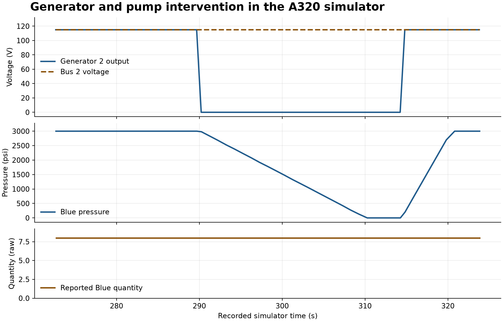

# AeroTrace

**An evidence-driven debugger for cross-system failures in an Airbus A320 simulation.**

AeroTrace reads FlightGear telemetry and explains which causal configurations fit the observed propulsion, electrical and hydraulic effects. It shows the evidence, contradictions and missing measurements for each candidate, and keeps competing explanations visible when the signals cannot distinguish them.

[v1.3 results and limitations](results/v1.3-investigation-20261107-01/REPORT.md) · [Architecture](docs/ARCHITECTURE.md) · [Reproduce the results](docs/REPRODUCING.md) · [Connect FlightGear](docs/LIVE-SIMULATOR.md)

## Investigate a recorded cascade

Run the Engine 2 example from the repository root with Python 3.11 or later.

```sh
python -B -m aircraft_debugger.sim_panel --investigate --replay results/engine-drive-20261106-01/engine-auto/observations.jsonl --port 8769
```

Advance to the last sample. The inspector shows which observations support the
shared Engine 2 power-loss path, which local failures could be masked, and the
measured conflicts in a counterfactual that excludes Engine 2 power loss.
Add `--pilot` for the concise view. Its support percentage describes matched
model checks. This airborne-only capture has no observed ground-power clock
origin, so the pilot timestamps show `--:--:--`. [Local evidence inspector](http://127.0.0.1:8769)

The v1.3 flagship example contains four overlapping paths. It shows why a
generator-only explanation fails, why the smallest compatible explanation
can omit an additional Blue supply loss, and why a shared physical origin
remains unresolved. [Flagship replay and comparison with v1.2](docs/CAUSAL-INVESTIGATION.md)

## What the experiments showed



The figure shows a recorded airborne A320 simulation. Generator 2 output reached zero while the monitored buses stayed near **115 volts**. Blue hydraulic pressure fell from **3,000 psi** (pounds per square inch) to zero while the reservoir indication stayed at **8 raw model units**. Both the independent-fault and shared-event configurations fit those observations. [Recording, diagnosis and operator evidence](results/pressure-pair-20261106-01/RESULT.md)

| Check | Result |
| --- | --- |
| **Prospective version 2 evaluation** | All **6** planned episodes matched their sealed candidate sets across **2** fresh simulator flights. All **276** public polls were complete. |
| **Live and recorded diagnosis** | The final live and replay results agreed for all six episodes, including the candidate sets, evidence and observed impact. |
| **Timed airborne study** | A staggered generator and pump intervention ruled out a shared trigger within the declared response limits. Near-synchronous effects left both explanations compatible. Recovery between interventions produced two separate incidents. |
| **Engine 2 drive-loss study** | All **4** planned contrasts matched their expected candidates. Generator and Yellow pump outputs fell in both failure patterns. Fuel flow and core speed distinguished the engine loss from the separate source failures. |
| **Five-fault sequence study** | The offline debugger tests **1,081** onset histories across **26** multi-fault sets and five isolated mechanisms using the same dependency graph. The software exercise retained the expected history in every synthetic case. Native replays show where timing narrows the order and where faults stay masked. |
| **v1.3 investigation** | All **12** comparisons preserved the original v1.2 fits. All **444** counterfactual checks agreed with the executable model. Missing drive channels split five explanations into predicted branches of four and one. The full mechanism set remained represented beyond the minimal explanation in the masked-fault stress case. |
| **Local update cost** | After airborne context reuse, the 95th-percentile update was **80 ms** over a synthetic 1,200-poll fixture, compared with **490 ms** before. Host background load differed between runs. These times cover local processing and snapshot copying. |
| **Software verification** | **230** automated tests cover the observation contract, causal inference, investigation, pilot display, replay, evaluation and operator controls. |

The v1.3 comparison retained the actual mechanism set in 10 of 12 cases in both
versions. An inconsistent synthetic fixture and an unmodelled bus-loss mechanism
produced explicit model mismatch. Timing also raised unresolved common-origin
possibilities on independent controls. The available telemetry leaves that
physical distinction unresolved. The earlier native study is preserved as a
dated report. [Full v1.3 comparison](results/v1.3-investigation-20261107-01/REPORT.md) · [Initial native validation report (PDF)](output/pdf/AeroTrace-Engineering-Report.pdf)

The release copy passed the 230-test suite and 110 additional recording,
missing-channel and observation-gap checks in a clean Python environment.
[Release review](results/v1.3-release-review-20261107-01/REPORT.md)

[Engine drive results](results/engine-drive-20261106-01/REPORT.md) · [Prospective evaluation](results/pressure-v2-prospective-20261106-01/REPORT.md) · [Timed fault study](docs/TEMPORAL-STUDY.md) · [Quantity stress test](results/quantity-indication-stress-20261106-01/README.md) · [Load measurements](results/pressure-v2-load-optimized-20261106-01/REPORT.md)

## Run the recorded demo

From the repository root, with **Python 3.11 or later**:

```sh
python -B -m aircraft_debugger.sim_panel --replay results/pressure-pair-20261106-01/pair/observations.jsonl --model v2 --port 8769
```

Open [the local evidence inspector](http://127.0.0.1:8769). Move from sample **17** through sample **22** to see how the candidate set changes as the hydraulic evidence arrives. Expand both compatible explanations, then advance to the end to compare recovered readings with the incident history. Recorded mode uses only Python and the included data.

Each candidate shows an **evidence support percentage** with the number of model checks behind it. Both explanations in the recorded demo reach 100% while the initiating cause remains ambiguous.

The [version 3 drive-loss replay](docs/ENGINE-DRIVE-STUDY.md#replay-and-compare) compares Engine 2 power loss with a generator and pump pair. It shows the measured alternate supply and explains why Yellow line pressure can persist after the engine-driven pump stops.

The [five-fault sequence replay](docs/FAULT-SEQUENCE-STUDY.md) explains which mechanism sets and onset orders fit a public recording, including why timing or observed effects exclude an order. The separate operator planner produces onset and release designs for future collection.

To write an inspectable diagnosis report, run the following command with an unused output directory:

```sh
python -B -m aircraft_debugger.diagnosis --observations results/pressure-pair-20261106-01/pair/observations.jsonl --model v2 --mode temporal --output work/paired-replay
```

Run the full test suite from the same folder:

```sh
python -B -m unittest discover -s tests -v
```

## What the debugger can explain

The current temporal v4 model evaluates all 32 sets of five mechanism classes
against generator output, bus voltage, indicated Blue quantity, Blue pressure,
engine drive and Yellow hydraulic supply. It distinguishes observed, absent
and unknown effects. Release v1.3 adds counterfactual queries, passive evidence
selection and explicit masking investigation to that model. The earlier v1,
v2 and v3 model selections remain available for reproducing their studies.

The simulator operator records fault commands and readiness checks separately. Diagnosis uses the public observations. The evaluator compares a completed prediction with the expected candidate set declared before the flight. The replay also preserves incident history after the current measurements recover.

The evaluations measure agreement with predeclared candidate sets at selected conditions in the FlightGear A320 model. The observed signals leave component identity, common physical damage and broader aircraft capability unresolved. The live inspector exposes its 1,200-poll inference limit.

## Project map

| Path | Contents |
| --- | --- |
| [aircraft_debugger/](aircraft_debugger/) | Telemetry validation, evidence extraction, causal models, live and replay panels |
| [configs/](configs/) | Aircraft setup, fault mappings, qualification rules and pinned simulator assets |
| [results/](results/) | Observation streams, expected profiles, saved diagnoses and experiment provenance |
| [tests/](tests/) | Automated checks and regressions using recorded observations |
| [docs/](docs/) | Engineering report, architecture, reproduction and simulator setup |

## License

Original AeroTrace work is licensed under the [Apache License 2.0](LICENSE).
Copyright 2026 Harsh Thakur.

Archived FlightGear/A320 model source retains its GNU General Public License
version 2 terms. See [third-party notices](THIRD_PARTY_NOTICES.md) for the
covered files, original copyright statements and license text.
