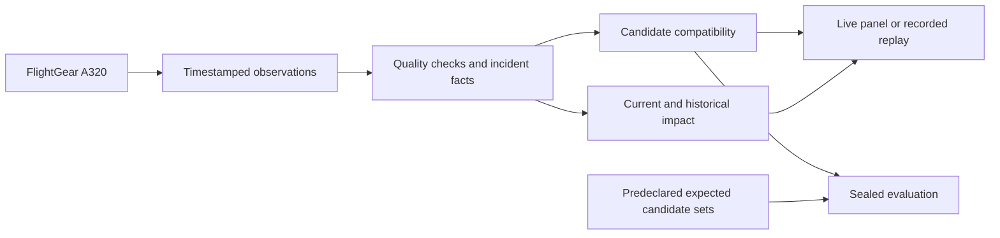

# Architecture

The live and replay paths use the same observation validation and causal model. The operator and evaluator keep experiment labels separate from the inputs to diagnosis.

| Layer | Responsibility |
| --- | --- |
| [FlightGear bridge](../aircraft_debugger/flightgear.py) | Poll selected local properties and preserve each reading's validity and timestamp. |
| [Observation profiles](../aircraft_debugger/airborne_profile.py) | Validate observations before they enter inference. The airborne profile retains flight context alongside system readings. |
| [Evidence extraction](../aircraft_debugger/diagnostic_features.py) | Track incident scope, reference periods, observed anomalies, missing evidence and onset intervals. |
| [Hypotheses](../aircraft_debugger/hypotheses.py) | Compare required and conditional effects. Keep tied explanations when predicted evidence agrees. |
| [Live session](../aircraft_debugger/diagnostic_session.py) and [replay](../aircraft_debugger/replay_panel.py) | Show the selected sample and its corresponding verdict. Retain the incident after recovery. |
| [Evaluator](../aircraft_debugger/evaluation.py) | Check a completed prediction against the sealed candidate set and verify the input and source digests. |

The version 2 model compares eight configurations built from three selected mechanism classes: generator source loss, Blue inventory loss and Blue pressure-supply loss. A retained bus can coexist with a failed source. A pressure-supply failure can reduce pressure while indicated quantity holds. Candidate compatibility describes fit to the selected observations. Distinguishing shared from independent physical causes would require additional evidence.

[Engineering report](ENGINEERING-REPORT.md) · [Reproduction guide](REPRODUCING.md)
