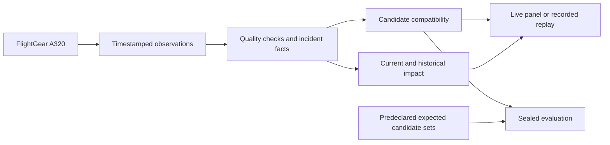

# Architecture

The live and replay paths use the same observation validation and causal model. The operator and evaluator keep experiment labels separate from the inputs to diagnosis.

| Layer | Responsibility |
| --- | --- |
| [FlightGear bridge](../aircraft_debugger/flightgear.py) | Poll selected local properties and preserve each reading's validity and timestamp. |
| [Observation profiles](../aircraft_debugger/airborne_profile.py) | Validate observations before they enter inference. The airborne profile retains flight context alongside system readings. |
| [Evidence extraction](../aircraft_debugger/diagnostic_features.py) | Track incident scope, reference periods, observed anomalies, missing evidence and onset intervals. |
| [Hypotheses](../aircraft_debugger/hypotheses.py) | Compare required and conditional effects. Keep tied explanations when predicted evidence agrees. |
| [Live session](../aircraft_debugger/diagnostic_session.py) and [replay](../aircraft_debugger/replay_panel.py) | Show the selected sample and its corresponding verdict. Retain the incident after recovery. |
| [Evaluator](../aircraft_debugger/evaluation.py) | Check a completed prediction against the sealed candidate set and verify the input and source digests. |

The version 2 model compares eight configurations built from three selected mechanism classes: generator source loss, Blue inventory loss and Blue pressure-supply loss. A retained bus can coexist with a failed source. A pressure-supply failure can reduce pressure while indicated quantity holds. Candidate compatibility describes fit to the selected observations. Distinguishing shared from independent physical causes would require additional evidence.

Version 3 adds Engine 2 power loss and local Yellow engine-driven pump supply loss. Its extended profile records core speed, fuel flow, pump outputs, transfer and Yellow line pressure. The graph connects engine drive to both dependent sources. An observed backup supply can preserve line pressure after the primary pump loses output. [Drive-loss study and measurement ablations](ENGINE-DRIVE-STUDY.md)

Version 4 generates every set of the five mechanism classes. The v1.1 offline history replay fits 1,081 onset histories to measured first responses and optional delay bounds. It keeps alternatives when multiple paths can explain the same evidence. [Five-fault sequence study](FAULT-SEQUENCE-STUDY.md)

[Engineering report](ENGINEERING-REPORT.md) · [Reproduction guide](REPRODUCING.md)
