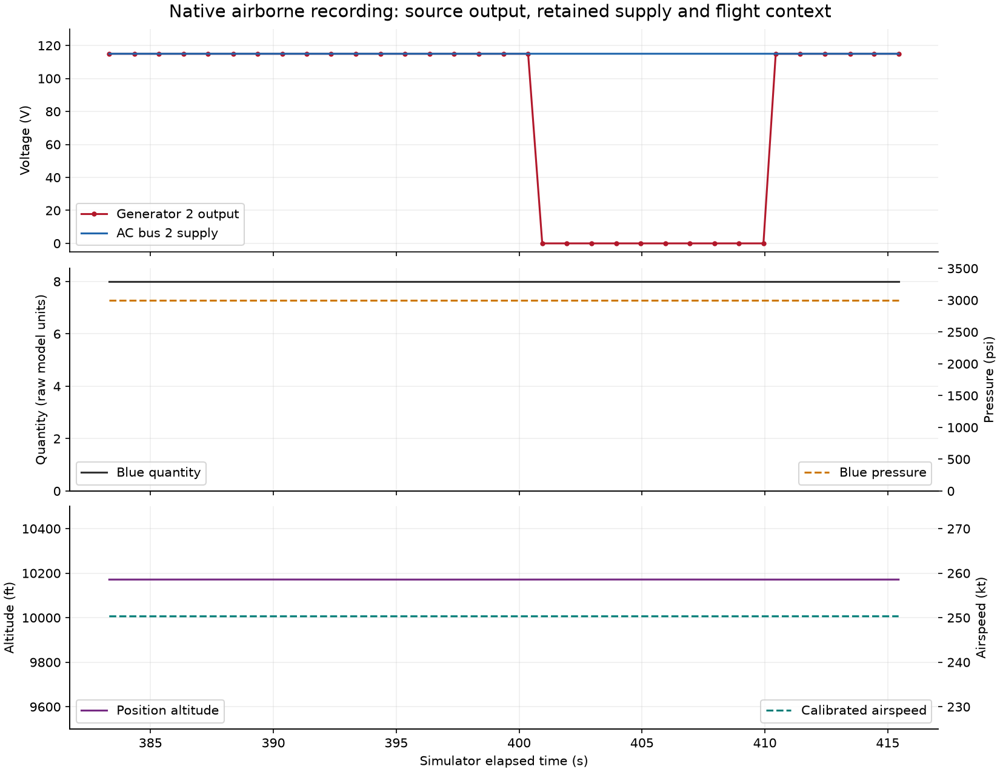

# Session 3: first controlled airborne fault and diagnostic replay

28 October 2026, Asia/Calcutta. **One isolated native generator-2 failure was recorded
in stable airborne flight, followed by verified clearing and observed recovery.**
The new context-aware analysis detects the source-output loss/restoration from public
observations only. This is one physical-response check, not broad fault coverage,
a diagnosis-accuracy benchmark or completion of all airborne/Week 1 requirements.

The tag `checkpoint/week01-airborne-gen2-20261028` and commit `9794d81` belong to the private
development history and are not part of this public repository. The executed source
bytes are archived with the recording.

## Intent and declared condition

The owner authorized proceeding after the bounded-scope discussion. The agent owns
launch/flight setup; the owner spectates after advance notice. Before the experiment,
the agent announced generator-2 failure, an eight-simulator-second active minimum,
clearing/recovery and the expected observations: source output near zero, retained
bus supply and unchanged selected blue hydraulic values. No additional fault was run.

A new flight used valid native ground initialization and normal pilot/Flight Control
Unit requests for takeoff/climb. The original
[10,000-foot/250-knot qualification settings](../configs/airborne-qualification-settings.json)
were chosen before collection. Stability/timing/readiness bands were unchanged. Actual
position altitude settled near 10,171 feet; the native selected indicated altitude
was 10,000 feet. These different altitude references remain distinct.

Native startup was complete with mismatch sentinel `XX`, both engines running,
aircraft-specific saved-state loading off, spoilers retracted and sufficient observed
fuel for this short setup. The successful retry used the source-audited native gear
function; later native actuator readbacks all showed zero (retracted). These setup
facts are separate private provenance, not extra diagnostic channels or a whole-
aircraft health assertion. All faults were clear before admission.

## Recorded result

[Recording manifest](../results/airborne-contrast-20261028-01/manifest.json).
All 34 public polls were complete and strictly valid schema 2. Eighteen public/private
admission pairs precede intervention; the final fresh gate spans 17.008333 simulator
seconds, including the extra pre-write sample. The final admission preceded the
verified enable within its local freshness expiry.

| Recorded stage | Public indices/count | Observed result |
|---|---|---|
| Baseline/admission | 0-17 / 18 polls | All twenty observations and six private checks pass; selected supplies/inventory near reference. |
| Active observation window | 18-27 / 10 polls | Generator-2 voltage zero in every poll; buses remain approximately 115 volts. Blue quantity 8 raw units and pressure 3,000 pounds per square inch throughout. |
| Recovery observation window | 28-33 / 6 polls | Generator-2 voltage restored to 115.000067-115.000229 volts; selected bus/hydraulic readings retained. |

Active minimum required-channel advancement was **9.0 simulator seconds**, despite an
8-second requested minimum. Recovery advancement was **5.0 simulator seconds**.
Sample cadence and independent reading timestamps prevent an exact-duration claim.
The journal records two attempts and two successful results: generator 2 enabled,
then disabled. The independent false-flag readback confirms cleanup; no pending owned
flags or cleanup errors remain. No blue leak was injected.

During the active window, position altitude ranged 10,171.304-10,171.548 feet and
calibrated airspeed 250.315-250.320 knots. Bank and vertical speed stayed close to
level; autopilot 1 and autothrust remained engaged. Those observations establish the
selected model response under automation, not healthy actuators or real-aircraft
capability. Retained bus voltage does not identify the alternate supply route.

The figure uses every public sample, without private phase labels or stability
filtering. V means volts, psi pounds per square inch, ft feet, kt knots (one nautical
mile per hour), and s simulator seconds. Blue quantity is a raw model scale with
unresolved physical volume units. Axis ranges are display choices, not flight limits.

## Public-only diagnostic replay

The [full report](../results/airborne-contrast-20261028-01/analysis/report.md) retains all
twenty-channel observations and context. Blind prefix replay in
[the timeline](../results/airborne-contrast-20261028-01/analysis/timeline.json) uses each
public prefix without reading experiment labels or phase boundaries.

- Initial evidence is incomplete until the detector has enough progressing readings.
- The source-output loss is confirmed at sample 19 after two advancing low-voltage
  observations; the selected-system category becomes `isolated_electrical_anomaly`.
- Source output restoration is observed at sample 28. The final recovered report is
  `no_fault_observed` for the selected systems, with loss/restoration preserved in the
  ledger. This does not mean no anomaly occurred or that every aircraft system is healthy.

The explanation remains an electrical supply/source anomaly. A native injected label
is not exposed to inference to make it claim unique generator-component failure.
This step reuses compatibility rules with retained flight context; it does not yet
execute the full dependency graph or compute root probabilities.

## Independent audit and software checks

[Private evaluator audit](../results/airborne-contrast-20261028-01/private_truth/verification.json)
verified all observation/check/action/settings hashes, all ten archived source files,
strict schema/public-private separation, timing bounds and exact replay of all eighteen
qualification decisions using verified archived modules. It checked stage durations,
only the intended two actions, cleanup readback and exact retention of all 34 rows.
Public-only analysis with file/network access blocked during inference exactly
reproduced the saved report. No live requests were made by this audit.

All **105 correctness checks passed in 7.252 seconds**, including 27 new controller,
airborne-analysis and pre-write deadline/identity checks. The old ground controller
and schema-1 analyzer semantics remain unchanged. Software fixtures do not count as
additional native trials or diagnostic accuracy measurements.

## Setup failures and limits preserved

The prior overnight process exposed neither a cockpit window nor a listening native
API, so it was replaced. An initial helper rejected a numeric native airborne-time
flag requested with the wrong Boolean type before takeoff; its abort pause is logged.
The first completed takeoff/climb later ended in a Windows-recorded `fgfs.exe` access
violation `0xc0000005` while a native HTTP screenshot request was outstanding. Cause
is unproven; no fault had been injected. A fresh retry completed the recorded episode
without using that endpoint.

The helper's early standard `gear-down` request was not treated as native gear proof;
the retry used `controls.gearDown` and native actuator readback. Its 160-knot rotation
trigger and normalized elevator request are original simulator setup choices, not
validated takeoff-performance values or a real-aircraft procedure.

Windows capture also failed after refreshed selection: `FrameArrived timed out`, then
`window capture timed out`. No cockpit screenshot is claimed for this stage. Native
telemetry, action acknowledgements/readbacks and replay supply its evidence. Supporting
logs, exact helper versions and the canonicalized Windows crash event are preserved in
[private setup provenance](../results/airborne-contrast-20261028-01/private_truth/operator_setup/index.json).
This is a supporting audit trail, not a complete input recorder.

The simulator was paused with both master/clock freezes after verified recovery;
both selected fault flags remain clear. The systems panel is restored for viewing.
A stored passing window does not qualify tomorrow's live state: re-establish fresh
admission before the next intervention and notify the owner beforehand.

Next stage: isolated blue-hydraulic depletion, followed by the supported paired
contrasts and the final Week 1 reproduction/review package. No additional native
fault families, engine explosion, manual-control-force effects, full airborne
validation, D: snapshot or real-aircraft safety result is claimed here.
