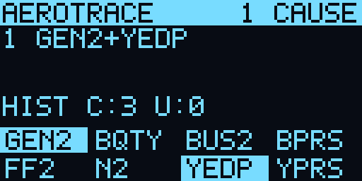

# Live flight diagnosed on the ESP32-P4

The pinned FlightGear A320-200-CFM qualified near 6,095 feet and 231 knots with both engines running. The controller enabled the Generator 2 and Yellow engine-driven pump (EDP) failure inputs together and left the power transfer unit (PTU) in automatic. The 58 complete public polls include 28.11 sampled simulator seconds during the intervention and 10.02 during recovery. Each poll was sent to the board as it was recorded. [Declared test](PROTOCOL.md) · [Public recording](run/observations.jsonl) · [Board replies](run/board-replies.jsonl) · [Reply check](run/board-check.json) · [Operator summary](run/private_truth/summary.json)

| Poll | Simulator time | What the board's screen showed |
| ---: | ---: | --- |
| 0 | 195.1 s | No fault; all eight effects unread |
| 1 to 17 | 196 to 212 s | No fault; all channels read |
| 18 | 213.1 s | One cause, Yellow EDP loss, unconfirmed; the generator effect not yet confirmed |
| 19 to 57 | 214.2 to 252.1 s | One cause, Generator 2 source path with Yellow EDP loss; three compatible onset histories |

Poll 18 was the first poll after the inputs were enabled. The screen is the image the firmware drew, read back over the text link; no display was attached to the board.

All 58 board replies equal the Python fit of the recording. The board reported a median of 46 microseconds for fact extraction and 151 microseconds for the fit, with a slowest fit of 3.2 milliseconds. The round trip from the PC, including the screen read-back, had a median of 93 milliseconds.

| Observation | Before | During the intervention | Final recorded value |
| --- | ---: | ---: | ---: |
| Generator 2 output | 115 volts | 0 volts | 115 volts |
| AC bus 2 | 115 volts | 115 volts | 115 volts |
| Engine 2 core speed | 77.6% | 77.6% | 77.6% |
| Yellow EDP output | 3,000 psi | 0 psi | 3,000 psi |
| Green-to-Yellow transfer | 0 psi | 2,700 psi | 0 psi |
| Yellow line pressure | 3,000 psi | 2,700 psi | 3,000 psi |

The intervention column is the reading at poll 45. Core speed is a percentage of the simulator reference high-pressure spool speed. Psi means pounds per square inch. AC bus 2 stayed powered while Generator 2 was off, so the bus effect was not observed.

The explanation stayed on the screen after both inputs were cleared and the readings recovered. The embedded fit reports the incident's history and does not yet close an incident.

The native control readback confirmed both failure inputs clear, and the simulator was then paused. This is one run of one fault pair in one operating condition. It shows that the implemented model behaves the same on the board as in Python with live input; it does not validate the model against a real aircraft.
