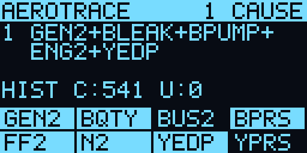

# Five staged faults diagnosed live on the ESP32-P4

The pinned FlightGear A320-200-CFM qualified near 6,096 feet and 231 knots with both engines running. The controller added the five failure inputs one step at a time and the board received each of the 101 public polls as it was recorded. The board ended with all five mechanisms as its only explanation, and all 101 replies equal the Python fit. [Declared test](PROTOCOL.md) · [Public recording](run/observations.jsonl) · [Board replies](run/board-replies.jsonl) · [Reply check](run/board-check.json) · [Operator summary](run/private_truth/summary.json)

| Poll | Simulator time | Input added by the controller | What the board's screen showed |
| ---: | ---: | --- | --- |
| 1 to 17 | 309 to 325 s | none | No fault |
| 18 | 325.3 s | Generator 2 | No fault; the generator effect not yet confirmed |
| 19 | 326.3 s | | One cause: GEN2 |
| 28 | 334.9 s | Blue electric pump | GEN2 (Blue pressure still above the threshold) |
| 32 | 338.9 s | | GEN2 + BPUMP |
| 40 | 346.6 s | Yellow EDP | GEN2 + BPUMP + YEDP |
| 52 | 358.2 s | Blue leak | GEN2 + BPUMP + YEDP |
| 53 | 359.2 s | | Two unconfirmed candidates: GEN2 + BLEAK + YEDP, or GEN2 + BPUMP + YEDP |
| 54 | 360.2 s | | GEN2 + BLEAK + BPUMP + YEDP |
| 69 | 374.8 s | Engine 2 fuel cutoff | GEN2 + BLEAK + BPUMP + YEDP |
| 71 to 72 | 376.8 to 377.8 s | | **No fit** |
| 73 to 100 | 378.8 to 406.1 s | | GEN2 + BLEAK + BPUMP + ENG2 + YEDP; 541 compatible onset histories |

The tags are the screen's labels: GEN2 for the Generator 2 source path, BPUMP for Blue pressure supply, YEDP for the Yellow engine-driven pump, BLEAK for Blue fluid loss and ENG2 for Engine 2 power loss.

**The two-poll "no fit".** After the cutoff, Engine 2 fuel flow fell below its threshold two polls before core speed did. In the model, Engine 2 power loss requires both effects, and no other mechanism explains a fuel-flow loss. So for two seconds the readings fitted no modelled cause, and the board said so. Python gave the same answer on the same polls. The final explanation appeared when core speed crossed its threshold. This is the model's behaviour during an engine run-down.

After this run the screen was changed to hold the previous explanation through such a gap. The fit and the saved replies are unchanged. Replaying this recording on the reflashed board shows CHECKING with the four earlier mechanisms marked "?" at polls 71 and 72, in place of the no-fit screen saved here. [Screen section of the README](../../README.md#screen)

**Blue pressure decayed slowly.** With the Blue electric pump failed, pressure fell from 3,000 psi by about 150 psi per second, so the pressure effect was confirmed four polls after the input. The leak then emptied the reservoir indication from 8.0 to 0 raw model units in about 30 seconds.

| Observation | Baseline | Poll 89, all five inputs selected | Final recorded value |
| --- | ---: | ---: | ---: |
| Generator 2 output | 115 volts | 0 volts | 0 volts |
| AC bus 2 | 115 volts | 115 volts | 115 volts |
| Blue line pressure | 3,000 psi | 0 psi | 3,000 psi |
| Blue reservoir indication | 8.0 raw model units | 0 | 8.0 |
| Engine 2 core speed | 77.6% | 11.9% | 11.9% |
| Engine 2 fuel flow | 3,548 raw model units | 0 | 0 |
| Yellow EDP output | 3,000 psi | 0 psi | 0 psi |
| Yellow line pressure | 3,000 psi | 2,700 psi | 2,700 psi |

Core speed is a percentage of the simulator reference high-pressure spool speed. Psi means pounds per square inch. The fuel-flow unit has not been established. AC bus 2 and Yellow line pressure stayed supplied throughout, so those two effects were never observed. Clearing the leak input restored the Blue quantity at once, which is a simulator simplification. Engine 2 did not relight after the cutoff was released, so the generator and Yellow pump stayed off.

The board reported a median of 45 microseconds for fact extraction and 190 microseconds for the fit, with a slowest fit of 3.2 milliseconds.

The native readback confirmed all five failure inputs clear, and the simulator was then paused with Engine 2 stopped. This is one run of one order of the five faults in one operating condition. The order was chosen so that each fault left separate evidence; other orders can leave several explanations standing. The run shows the board reproduces the implemented model on live input. It does not validate the model against a real aircraft.
