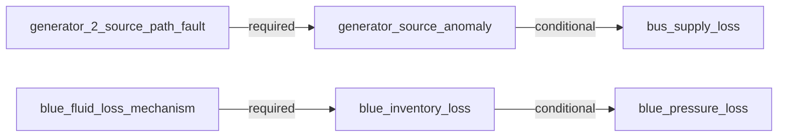

# AeroTrace causal diagnosis

Outcome: **poor_model_fit**.
Public observations: 53; method: `dependency_compatibility_with_temporal_constraints`.

Explanation scope: {"closed": true, "end_sample_index": 49, "epoch": 0, "incident_id": "I0001", "kind": "last_observed_incident", "reference_sample_index": 17, "start_sample_index": 18}

Compatible model candidates: none
Plausible candidates awaiting evidence: none

A surviving model configuration does not establish a unique physical cause or probability.

**What could reduce uncertainty.**
No additional selected discriminator is identified for the surviving configuration.

**Executable dependency model.** Conditional links permit retained downstream supply.

**Confirmed incident degradation.**
- Generator-2 source-output degradation was observed in this incident. Bus observations are separate; source loss does not establish total downstream supply loss. Evidence: generator_2_voltage at sample 19: 0.0 V; generator_2_voltage at sample 42: 0.0 V.
- Blue pressure degradation was observed in this incident. Pressure degradation does not establish total controllability or manual-control force. Evidence: blue_pressure at sample 22: 2380.0 psi; blue_pressure at sample 47: 2200.0 psi.

**Current observed impact.**
No selected confirmed impact in this scope; this is not a whole-aircraft health statement.

**Hypothesis: No selected mechanism currently required** (`selected_reference`).
Status: `contradicted`.
Supporting evidence:
- blue inventory loss: Usable observation agrees with the executable dependency prediction. Evidence: blue_quantity at sample 49: 8.0 raw model quantity.
- bus supply loss: Usable observation agrees with the executable dependency prediction. Evidence: ac_bus_2 at sample 49: 115.000773 V.
Contradicting evidence:
- generator source anomaly: This observed effect is not explained by the candidate's selected dependency paths. Evidence: generator_2_voltage at sample 19: 0.0 V; generator_2_voltage at sample 42: 0.0 V.
- blue pressure loss: This observed effect is not explained by the candidate's selected dependency paths. Evidence: blue_pressure at sample 22: 2380.0 psi; blue_pressure at sample 47: 2200.0 psi.
Predicted consequences:
- generator source anomaly: This observed effect is not explained by the candidate's selected dependency paths. Evidence: generator_2_voltage at sample 19: 0.0 V; generator_2_voltage at sample 42: 0.0 V.
- blue inventory loss: Usable observation agrees with the executable dependency prediction. Evidence: blue_quantity at sample 49: 8.0 raw model quantity.
- bus supply loss: Usable observation agrees with the executable dependency prediction. Evidence: ac_bus_2 at sample 49: 115.000773 V.
- blue pressure loss: This observed effect is not explained by the candidate's selected dependency paths. Evidence: blue_pressure at sample 22: 2380.0 psi; blue_pressure at sample 47: 2200.0 psi.
Possible dependency paths:
- None recorded for this candidate.
Missing evidence:
- None recorded for this candidate.
Alternative compatible candidates: none

**Hypothesis: Generator 2 source-path fault** (`generator_2_source_path_fault`).
Status: `contradicted`.
Supporting evidence:
- generator source anomaly: Usable observation agrees with the executable dependency prediction. Evidence: generator_2_voltage at sample 19: 0.0 V; generator_2_voltage at sample 42: 0.0 V.
- blue inventory loss: Usable observation agrees with the executable dependency prediction. Evidence: blue_quantity at sample 49: 8.0 raw model quantity.
- bus supply loss: This downstream effect is conditional; either retained or degraded output is compatible. Evidence: ac_bus_2 at sample 49: 115.000773 V.
Contradicting evidence:
- blue pressure loss: This observed effect is not explained by the candidate's selected dependency paths. Evidence: blue_pressure at sample 22: 2380.0 psi; blue_pressure at sample 47: 2200.0 psi.
Predicted consequences:
- generator source anomaly: Usable observation agrees with the executable dependency prediction. Evidence: generator_2_voltage at sample 19: 0.0 V; generator_2_voltage at sample 42: 0.0 V.
- blue inventory loss: Usable observation agrees with the executable dependency prediction. Evidence: blue_quantity at sample 49: 8.0 raw model quantity.
- bus supply loss: This downstream effect is conditional; either retained or degraded output is compatible. Evidence: ac_bus_2 at sample 49: 115.000773 V.
- blue pressure loss: This observed effect is not explained by the candidate's selected dependency paths. Evidence: blue_pressure at sample 22: 2380.0 psi; blue_pressure at sample 47: 2200.0 psi.
Possible dependency paths:
- generator_2_source_path_fault -> generator_source_anomaly (required). The selected source-path mechanism predicts abnormal generator-2 output.
- generator_2_source_path_fault -> generator_source_anomaly -> bus_supply_loss (conditional). The selected source-path mechanism predicts abnormal generator-2 output. Downstream supply can be lost if alternate supply is unavailable; retained bus voltage is compatible and does not identify its supply route.
Missing evidence:
- None recorded for this candidate.
Alternative compatible candidates: none

**Hypothesis: Blue fluid-inventory-loss analogue** (`blue_inventory_loss`).
Status: `contradicted`.
Supporting evidence:
- bus supply loss: Usable observation agrees with the executable dependency prediction. Evidence: ac_bus_2 at sample 49: 115.000773 V.
- blue pressure loss: This downstream effect is conditional; either retained or degraded output is compatible. Evidence: blue_pressure at sample 22: 2380.0 psi; blue_pressure at sample 47: 2200.0 psi.
Contradicting evidence:
- generator source anomaly: This observed effect is not explained by the candidate's selected dependency paths. Evidence: generator_2_voltage at sample 19: 0.0 V; generator_2_voltage at sample 42: 0.0 V.
- blue inventory loss: The candidate requires this effect, but it is not observed in the supplied incident scope. Evidence: blue_quantity at sample 49: 8.0 raw model quantity.
Predicted consequences:
- generator source anomaly: This observed effect is not explained by the candidate's selected dependency paths. Evidence: generator_2_voltage at sample 19: 0.0 V; generator_2_voltage at sample 42: 0.0 V.
- blue inventory loss: The candidate requires this effect, but it is not observed in the supplied incident scope. Evidence: blue_quantity at sample 49: 8.0 raw model quantity.
- bus supply loss: Usable observation agrees with the executable dependency prediction. Evidence: ac_bus_2 at sample 49: 115.000773 V.
- blue pressure loss: This downstream effect is conditional; either retained or degraded output is compatible. Evidence: blue_pressure at sample 22: 2380.0 psi; blue_pressure at sample 47: 2200.0 psi.
Possible dependency paths:
- blue_fluid_loss_mechanism -> blue_inventory_loss (required). The selected fluid-loss analogue predicts inventory decline from an observed reference.
- blue_fluid_loss_mechanism -> blue_inventory_loss -> blue_pressure_loss (conditional). The selected fluid-loss analogue predicts inventory decline from an observed reference. Pressure can degrade as inventory/supply becomes insufficient; early retained pressure and subsequent restoration lag are allowed. No exact delay is assumed.
Missing evidence:
- None recorded for this candidate.
Alternative compatible candidates: none

**Hypothesis: Independent source-path and blue inventory-loss mechanisms** (`independent_pair`).
Status: `contradicted`.
Supporting evidence:
- generator source anomaly: Usable observation agrees with the executable dependency prediction. Evidence: generator_2_voltage at sample 19: 0.0 V; generator_2_voltage at sample 42: 0.0 V.
- bus supply loss: This downstream effect is conditional; either retained or degraded output is compatible. Evidence: ac_bus_2 at sample 49: 115.000773 V.
- blue pressure loss: This downstream effect is conditional; either retained or degraded output is compatible. Evidence: blue_pressure at sample 22: 2380.0 psi; blue_pressure at sample 47: 2200.0 psi.
Contradicting evidence:
- blue inventory loss: The candidate requires this effect, but it is not observed in the supplied incident scope. Evidence: blue_quantity at sample 49: 8.0 raw model quantity.
Predicted consequences:
- generator source anomaly: Usable observation agrees with the executable dependency prediction. Evidence: generator_2_voltage at sample 19: 0.0 V; generator_2_voltage at sample 42: 0.0 V.
- blue inventory loss: The candidate requires this effect, but it is not observed in the supplied incident scope. Evidence: blue_quantity at sample 49: 8.0 raw model quantity.
- bus supply loss: This downstream effect is conditional; either retained or degraded output is compatible. Evidence: ac_bus_2 at sample 49: 115.000773 V.
- blue pressure loss: This downstream effect is conditional; either retained or degraded output is compatible. Evidence: blue_pressure at sample 22: 2380.0 psi; blue_pressure at sample 47: 2200.0 psi.
Possible dependency paths:
- generator_2_source_path_fault -> generator_source_anomaly (required). The selected source-path mechanism predicts abnormal generator-2 output.
- generator_2_source_path_fault -> generator_source_anomaly -> bus_supply_loss (conditional). The selected source-path mechanism predicts abnormal generator-2 output. Downstream supply can be lost if alternate supply is unavailable; retained bus voltage is compatible and does not identify its supply route.
- blue_fluid_loss_mechanism -> blue_inventory_loss (required). The selected fluid-loss analogue predicts inventory decline from an observed reference.
- blue_fluid_loss_mechanism -> blue_inventory_loss -> blue_pressure_loss (conditional). The selected fluid-loss analogue predicts inventory decline from an observed reference. Pressure can degrade as inventory/supply becomes insufficient; early retained pressure and subsequent restoration lag are allowed. No exact delay is assumed.
Missing evidence:
- None recorded for this candidate.
Alternative compatible candidates: none

**Hypothesis: One grouped event affecting both selected mechanisms** (`grouped_joint_event`).
Status: `contradicted`.
Supporting evidence:
- generator source anomaly: Usable observation agrees with the executable dependency prediction. Evidence: generator_2_voltage at sample 19: 0.0 V; generator_2_voltage at sample 42: 0.0 V.
- bus supply loss: This downstream effect is conditional; either retained or degraded output is compatible. Evidence: ac_bus_2 at sample 49: 115.000773 V.
- blue pressure loss: This downstream effect is conditional; either retained or degraded output is compatible. Evidence: blue_pressure at sample 22: 2380.0 psi; blue_pressure at sample 47: 2200.0 psi.
Contradicting evidence:
- blue inventory loss: The candidate requires this effect, but it is not observed in the supplied incident scope. Evidence: blue_quantity at sample 49: 8.0 raw model quantity.
Predicted consequences:
- generator source anomaly: Usable observation agrees with the executable dependency prediction. Evidence: generator_2_voltage at sample 19: 0.0 V; generator_2_voltage at sample 42: 0.0 V.
- blue inventory loss: The candidate requires this effect, but it is not observed in the supplied incident scope. Evidence: blue_quantity at sample 49: 8.0 raw model quantity.
- bus supply loss: This downstream effect is conditional; either retained or degraded output is compatible. Evidence: ac_bus_2 at sample 49: 115.000773 V.
- blue pressure loss: This downstream effect is conditional; either retained or degraded output is compatible. Evidence: blue_pressure at sample 22: 2380.0 psi; blue_pressure at sample 47: 2200.0 psi.
Possible dependency paths:
- generator_2_source_path_fault -> generator_source_anomaly (required). The selected source-path mechanism predicts abnormal generator-2 output.
- generator_2_source_path_fault -> generator_source_anomaly -> bus_supply_loss (conditional). The selected source-path mechanism predicts abnormal generator-2 output. Downstream supply can be lost if alternate supply is unavailable; retained bus voltage is compatible and does not identify its supply route.
- blue_fluid_loss_mechanism -> blue_inventory_loss (required). The selected fluid-loss analogue predicts inventory decline from an observed reference.
- blue_fluid_loss_mechanism -> blue_inventory_loss -> blue_pressure_loss (conditional). The selected fluid-loss analogue predicts inventory decline from an observed reference. Pressure can degrade as inventory/supply becomes insufficient; early retained pressure and subsequent restoration lag are allowed. No exact delay is assumed.
Missing evidence:
- None recorded for this candidate.
Alternative compatible candidates: none

**Diagnostic timeline.**

| Sample | Epoch | Simulator seconds | Status | Compatible candidates |
|---:|---:|---:|---|---|
| 0 | 0 | 272.6 | insufficient_observations |  |
| 1 | 0 | 273.616667 | no_selected_anomaly | selected_reference |
| 2 | 0 | 274.608333 | no_selected_anomaly | selected_reference |
| 3 | 0 | 275.6 | no_selected_anomaly | selected_reference |
| 4 | 0 | 276.6 | no_selected_anomaly | selected_reference |
| 5 | 0 | 277.616667 | no_selected_anomaly | selected_reference |
| 6 | 0 | 278.591667 | no_selected_anomaly | selected_reference |
| 7 | 0 | 279.6 | no_selected_anomaly | selected_reference |
| 8 | 0 | 280.608333 | no_selected_anomaly | selected_reference |
| 9 | 0 | 281.6 | no_selected_anomaly | selected_reference |
| 10 | 0 | 282.608333 | no_selected_anomaly | selected_reference |
| 11 | 0 | 283.591667 | no_selected_anomaly | selected_reference |
| 12 | 0 | 284.591667 | no_selected_anomaly | selected_reference |
| 13 | 0 | 285.608333 | no_selected_anomaly | selected_reference |
| 14 | 0 | 286.608333 | no_selected_anomaly | selected_reference |
| 15 | 0 | 287.6 | no_selected_anomaly | selected_reference |
| 16 | 0 | 288.608333 | no_selected_anomaly | selected_reference |
| 17 | 0 | 289.616667 | no_selected_anomaly | selected_reference |
| 18 | 0 | 290.158333 | insufficient_observations |  |
| 19 | 0 | 291.166667 | single_compatible_candidate | generator_2_source_path_fault |
| 20 | 0 | 292.166667 | single_compatible_candidate | generator_2_source_path_fault |
| 21 | 0 | 293.175 | single_compatible_candidate | generator_2_source_path_fault |
| 22 | 0 | 294.183333 | poor_model_fit |  |
| 23 | 0 | 295.166667 | poor_model_fit |  |
| 24 | 0 | 296.191667 | poor_model_fit |  |
| 25 | 0 | 297.175 | poor_model_fit |  |
| 26 | 0 | 298.166667 | poor_model_fit |  |
| 27 | 0 | 299.158333 | poor_model_fit |  |
| 28 | 0 | 300.166667 | poor_model_fit |  |
| 29 | 0 | 301.175 | poor_model_fit |  |
| 30 | 0 | 302.175 | poor_model_fit |  |
| 31 | 0 | 303.166667 | poor_model_fit |  |
| 32 | 0 | 304.191667 | poor_model_fit |  |
| 33 | 0 | 305.166667 | poor_model_fit |  |
| 34 | 0 | 306.175 | poor_model_fit |  |
| 35 | 0 | 307.175 | poor_model_fit |  |
| 36 | 0 | 308.166667 | poor_model_fit |  |
| 37 | 0 | 309.175 | poor_model_fit |  |
| 38 | 0 | 310.183333 | poor_model_fit |  |
| 39 | 0 | 311.2 | poor_model_fit |  |
| 40 | 0 | 312.191667 | poor_model_fit |  |
| 41 | 0 | 313.183333 | poor_model_fit |  |
| 42 | 0 | 314.183333 | poor_model_fit |  |
| 43 | 0 | 314.741667 | poor_model_fit |  |
| 44 | 0 | 315.725 | poor_model_fit |  |
| 45 | 0 | 316.716667 | poor_model_fit |  |
| 46 | 0 | 317.725 | poor_model_fit |  |
| 47 | 0 | 318.725 | poor_model_fit |  |
| 48 | 0 | 319.716667 | poor_model_fit |  |
| 49 | 0 | 320.725 | poor_model_fit |  |
| 50 | 0 | 321.716667 | poor_model_fit |  |
| 51 | 0 | 322.716667 | poor_model_fit |  |
| 52 | 0 | 323.733333 | poor_model_fit |  |

**Limits.**
- Five bounded candidate configurations reuse two verified native mechanisms; this is not complete aircraft diagnosis.
- A compatible model candidate is not a uniquely identified physical component failure or calibrated probability.
- The grouped joint-event and independent pair have identical observable predictions in this model; no available observation is invented to distinguish them.
- Incident-history hypotheses and confirmed incident degradation remain separate from current recovered or unavailable readings.
- The simulator and diagnostic model are related engineering abstractions, not independent real-aircraft validation.
- Temporal constraints are qualitative model assumptions; native depletion rates and exact propagation delays are not fitted signatures.
- The first offline path uses repeated prefix analysis; computation and memory suitability for a live display require separate measurement.
