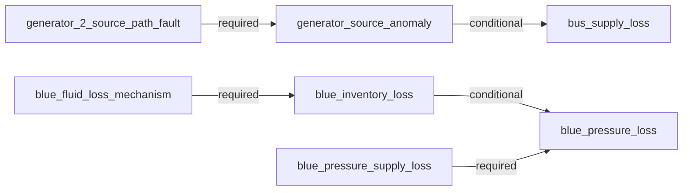

# AeroTrace causal diagnosis

Outcome: **causal_ambiguity**.
Public observations: 53; method: `dependency_compatibility_with_temporal_constraints`.

Explanation scope: {"closed": true, "end_sample_index": 49, "epoch": 0, "incident_id": "I0001", "kind": "last_observed_incident", "reference_sample_index": 16, "start_sample_index": 17}

Compatible model candidates: independent_pressure_pair, grouped_pressure_joint_event
Plausible candidates awaiting evidence: none

A surviving model configuration does not establish a unique physical cause or probability.

**What could reduce uncertainty.**
- Both candidates have identical predicted effects and temporal rules across the selected observation model. No available modeled measurement can establish their initiating history.

**Executable dependency model.** Conditional links permit retained downstream supply.

**Confirmed incident degradation.**
- Generator-2 source-output degradation was observed in this incident. Bus observations are separate; source loss does not establish total downstream supply loss. Evidence: generator_2_voltage at sample 18: 0.0 V; generator_2_voltage at sample 42: 0.0 V.
- Blue pressure degradation was observed in this incident. Pressure degradation does not establish total controllability or manual-control force. Evidence: blue_pressure at sample 21: 2370.0 psi; blue_pressure at sample 47: 2166.666667 psi.

**Current observed impact.**
No selected confirmed impact in this scope; this is not a whole-aircraft health statement.

**Hypothesis: No selected mechanism currently required** (`selected_reference`).
Status: `contradicted`.
Supporting evidence:
- blue inventory loss: Usable observation agrees with the executable dependency prediction. Evidence: blue_quantity at sample 49: 8.0 raw model quantity.
- bus supply loss: Usable observation agrees with the executable dependency prediction. Evidence: ac_bus_2 at sample 49: 115.000534 V.
Contradicting evidence:
- generator source anomaly: This observed effect is not explained by the candidate's selected dependency paths. Evidence: generator_2_voltage at sample 18: 0.0 V; generator_2_voltage at sample 42: 0.0 V.
- blue pressure loss: This observed effect is not explained by the candidate's selected dependency paths. Evidence: blue_pressure at sample 21: 2370.0 psi; blue_pressure at sample 47: 2166.666667 psi.
Predicted consequences:
- generator source anomaly: This observed effect is not explained by the candidate's selected dependency paths. Evidence: generator_2_voltage at sample 18: 0.0 V; generator_2_voltage at sample 42: 0.0 V.
- blue inventory loss: Usable observation agrees with the executable dependency prediction. Evidence: blue_quantity at sample 49: 8.0 raw model quantity.
- bus supply loss: Usable observation agrees with the executable dependency prediction. Evidence: ac_bus_2 at sample 49: 115.000534 V.
- blue pressure loss: This observed effect is not explained by the candidate's selected dependency paths. Evidence: blue_pressure at sample 21: 2370.0 psi; blue_pressure at sample 47: 2166.666667 psi.
Possible dependency paths:
- None recorded for this candidate.
Missing evidence:
- None recorded for this candidate.
Alternative compatible candidates: independent_pressure_pair, grouped_pressure_joint_event

**Hypothesis: Generator 2 source-path fault** (`generator_2_source_path_fault`).
Status: `contradicted`.
Supporting evidence:
- generator source anomaly: Usable observation agrees with the executable dependency prediction. Evidence: generator_2_voltage at sample 18: 0.0 V; generator_2_voltage at sample 42: 0.0 V.
- blue inventory loss: Usable observation agrees with the executable dependency prediction. Evidence: blue_quantity at sample 49: 8.0 raw model quantity.
- bus supply loss: This downstream effect is conditional; either retained or degraded output is compatible. Evidence: ac_bus_2 at sample 49: 115.000534 V.
Contradicting evidence:
- blue pressure loss: This observed effect is not explained by the candidate's selected dependency paths. Evidence: blue_pressure at sample 21: 2370.0 psi; blue_pressure at sample 47: 2166.666667 psi.
Predicted consequences:
- generator source anomaly: Usable observation agrees with the executable dependency prediction. Evidence: generator_2_voltage at sample 18: 0.0 V; generator_2_voltage at sample 42: 0.0 V.
- blue inventory loss: Usable observation agrees with the executable dependency prediction. Evidence: blue_quantity at sample 49: 8.0 raw model quantity.
- bus supply loss: This downstream effect is conditional; either retained or degraded output is compatible. Evidence: ac_bus_2 at sample 49: 115.000534 V.
- blue pressure loss: This observed effect is not explained by the candidate's selected dependency paths. Evidence: blue_pressure at sample 21: 2370.0 psi; blue_pressure at sample 47: 2166.666667 psi.
Possible dependency paths:
- generator_2_source_path_fault -> generator_source_anomaly (required). The selected source-path mechanism predicts abnormal generator-2 output.
- generator_2_source_path_fault -> generator_source_anomaly -> bus_supply_loss (conditional). The selected source-path mechanism predicts abnormal generator-2 output. Downstream supply can be lost if alternate supply is unavailable; retained bus voltage is compatible and does not identify its supply route.
Missing evidence:
- None recorded for this candidate.
Alternative compatible candidates: independent_pressure_pair, grouped_pressure_joint_event

**Hypothesis: Blue fluid-inventory-loss analogue** (`blue_inventory_loss`).
Status: `contradicted`.
Supporting evidence:
- bus supply loss: Usable observation agrees with the executable dependency prediction. Evidence: ac_bus_2 at sample 49: 115.000534 V.
- blue pressure loss: This downstream effect is conditional; either retained or degraded output is compatible. Evidence: blue_pressure at sample 21: 2370.0 psi; blue_pressure at sample 47: 2166.666667 psi.
Contradicting evidence:
- generator source anomaly: This observed effect is not explained by the candidate's selected dependency paths. Evidence: generator_2_voltage at sample 18: 0.0 V; generator_2_voltage at sample 42: 0.0 V.
- blue inventory loss: The candidate requires this effect, but it is not observed in the supplied incident scope. Evidence: blue_quantity at sample 49: 8.0 raw model quantity.
Predicted consequences:
- generator source anomaly: This observed effect is not explained by the candidate's selected dependency paths. Evidence: generator_2_voltage at sample 18: 0.0 V; generator_2_voltage at sample 42: 0.0 V.
- blue inventory loss: The candidate requires this effect, but it is not observed in the supplied incident scope. Evidence: blue_quantity at sample 49: 8.0 raw model quantity.
- bus supply loss: Usable observation agrees with the executable dependency prediction. Evidence: ac_bus_2 at sample 49: 115.000534 V.
- blue pressure loss: This downstream effect is conditional; either retained or degraded output is compatible. Evidence: blue_pressure at sample 21: 2370.0 psi; blue_pressure at sample 47: 2166.666667 psi.
Possible dependency paths:
- blue_fluid_loss_mechanism -> blue_inventory_loss (required). The selected fluid-loss analogue predicts inventory decline from an observed reference.
- blue_fluid_loss_mechanism -> blue_inventory_loss -> blue_pressure_loss (conditional). The selected fluid-loss analogue predicts inventory decline from an observed reference. Pressure can degrade as inventory/supply becomes insufficient; early retained pressure and subsequent restoration lag are allowed. No exact delay is assumed.
Missing evidence:
- None recorded for this candidate.
Alternative compatible candidates: independent_pressure_pair, grouped_pressure_joint_event

**Hypothesis: Independent source-path and blue inventory-loss mechanisms** (`independent_pair`).
Status: `contradicted`.
Supporting evidence:
- generator source anomaly: Usable observation agrees with the executable dependency prediction. Evidence: generator_2_voltage at sample 18: 0.0 V; generator_2_voltage at sample 42: 0.0 V.
- bus supply loss: This downstream effect is conditional; either retained or degraded output is compatible. Evidence: ac_bus_2 at sample 49: 115.000534 V.
- blue pressure loss: This downstream effect is conditional; either retained or degraded output is compatible. Evidence: blue_pressure at sample 21: 2370.0 psi; blue_pressure at sample 47: 2166.666667 psi.
Contradicting evidence:
- blue inventory loss: The candidate requires this effect, but it is not observed in the supplied incident scope. Evidence: blue_quantity at sample 49: 8.0 raw model quantity.
Predicted consequences:
- generator source anomaly: Usable observation agrees with the executable dependency prediction. Evidence: generator_2_voltage at sample 18: 0.0 V; generator_2_voltage at sample 42: 0.0 V.
- blue inventory loss: The candidate requires this effect, but it is not observed in the supplied incident scope. Evidence: blue_quantity at sample 49: 8.0 raw model quantity.
- bus supply loss: This downstream effect is conditional; either retained or degraded output is compatible. Evidence: ac_bus_2 at sample 49: 115.000534 V.
- blue pressure loss: This downstream effect is conditional; either retained or degraded output is compatible. Evidence: blue_pressure at sample 21: 2370.0 psi; blue_pressure at sample 47: 2166.666667 psi.
Possible dependency paths:
- generator_2_source_path_fault -> generator_source_anomaly (required). The selected source-path mechanism predicts abnormal generator-2 output.
- generator_2_source_path_fault -> generator_source_anomaly -> bus_supply_loss (conditional). The selected source-path mechanism predicts abnormal generator-2 output. Downstream supply can be lost if alternate supply is unavailable; retained bus voltage is compatible and does not identify its supply route.
- blue_fluid_loss_mechanism -> blue_inventory_loss (required). The selected fluid-loss analogue predicts inventory decline from an observed reference.
- blue_fluid_loss_mechanism -> blue_inventory_loss -> blue_pressure_loss (conditional). The selected fluid-loss analogue predicts inventory decline from an observed reference. Pressure can degrade as inventory/supply becomes insufficient; early retained pressure and subsequent restoration lag are allowed. No exact delay is assumed.
Missing evidence:
- None recorded for this candidate.
Alternative compatible candidates: independent_pressure_pair, grouped_pressure_joint_event

**Hypothesis: One grouped event affecting both selected mechanisms** (`grouped_joint_event`).
Status: `contradicted`.
Supporting evidence:
- generator source anomaly: Usable observation agrees with the executable dependency prediction. Evidence: generator_2_voltage at sample 18: 0.0 V; generator_2_voltage at sample 42: 0.0 V.
- bus supply loss: This downstream effect is conditional; either retained or degraded output is compatible. Evidence: ac_bus_2 at sample 49: 115.000534 V.
- blue pressure loss: This downstream effect is conditional; either retained or degraded output is compatible. Evidence: blue_pressure at sample 21: 2370.0 psi; blue_pressure at sample 47: 2166.666667 psi.
Contradicting evidence:
- blue inventory loss: The candidate requires this effect, but it is not observed in the supplied incident scope. Evidence: blue_quantity at sample 49: 8.0 raw model quantity.
Predicted consequences:
- generator source anomaly: Usable observation agrees with the executable dependency prediction. Evidence: generator_2_voltage at sample 18: 0.0 V; generator_2_voltage at sample 42: 0.0 V.
- blue inventory loss: The candidate requires this effect, but it is not observed in the supplied incident scope. Evidence: blue_quantity at sample 49: 8.0 raw model quantity.
- bus supply loss: This downstream effect is conditional; either retained or degraded output is compatible. Evidence: ac_bus_2 at sample 49: 115.000534 V.
- blue pressure loss: This downstream effect is conditional; either retained or degraded output is compatible. Evidence: blue_pressure at sample 21: 2370.0 psi; blue_pressure at sample 47: 2166.666667 psi.
Possible dependency paths:
- generator_2_source_path_fault -> generator_source_anomaly (required). The selected source-path mechanism predicts abnormal generator-2 output.
- generator_2_source_path_fault -> generator_source_anomaly -> bus_supply_loss (conditional). The selected source-path mechanism predicts abnormal generator-2 output. Downstream supply can be lost if alternate supply is unavailable; retained bus voltage is compatible and does not identify its supply route.
- blue_fluid_loss_mechanism -> blue_inventory_loss (required). The selected fluid-loss analogue predicts inventory decline from an observed reference.
- blue_fluid_loss_mechanism -> blue_inventory_loss -> blue_pressure_loss (conditional). The selected fluid-loss analogue predicts inventory decline from an observed reference. Pressure can degrade as inventory/supply becomes insufficient; early retained pressure and subsequent restoration lag are allowed. No exact delay is assumed.
Missing evidence:
- None recorded for this candidate.
Alternative compatible candidates: independent_pressure_pair, grouped_pressure_joint_event

**Hypothesis: Blue pressure-supply-path loss** (`blue_pressure_supply_loss`).
Status: `contradicted`.
Supporting evidence:
- blue inventory loss: Usable observation agrees with the executable dependency prediction. Evidence: blue_quantity at sample 49: 8.0 raw model quantity.
- bus supply loss: Usable observation agrees with the executable dependency prediction. Evidence: ac_bus_2 at sample 49: 115.000534 V.
- blue pressure loss: Usable observation agrees with the executable dependency prediction. Evidence: blue_pressure at sample 21: 2370.0 psi; blue_pressure at sample 47: 2166.666667 psi.
Contradicting evidence:
- generator source anomaly: This observed effect is not explained by the candidate's selected dependency paths. Evidence: generator_2_voltage at sample 18: 0.0 V; generator_2_voltage at sample 42: 0.0 V.
Predicted consequences:
- generator source anomaly: This observed effect is not explained by the candidate's selected dependency paths. Evidence: generator_2_voltage at sample 18: 0.0 V; generator_2_voltage at sample 42: 0.0 V.
- blue inventory loss: Usable observation agrees with the executable dependency prediction. Evidence: blue_quantity at sample 49: 8.0 raw model quantity.
- bus supply loss: Usable observation agrees with the executable dependency prediction. Evidence: ac_bus_2 at sample 49: 115.000534 V.
- blue pressure loss: Usable observation agrees with the executable dependency prediction. Evidence: blue_pressure at sample 21: 2370.0 psi; blue_pressure at sample 47: 2166.666667 psi.
Possible dependency paths:
- blue_pressure_supply_loss -> blue_pressure_loss (required). The represented net blue pressure-supply-path loss predicts degraded pressure without requiring inventory loss; alternate supply and component identity are not observed.
Missing evidence:
- None recorded for this candidate.
Alternative compatible candidates: independent_pressure_pair, grouped_pressure_joint_event

**Hypothesis: Independent source-path and blue pressure-supply losses** (`independent_pressure_pair`).
Status: `compatible`.
Supporting evidence:
- generator source anomaly: Usable observation agrees with the executable dependency prediction. Evidence: generator_2_voltage at sample 18: 0.0 V; generator_2_voltage at sample 42: 0.0 V.
- blue inventory loss: Usable observation agrees with the executable dependency prediction. Evidence: blue_quantity at sample 49: 8.0 raw model quantity.
- bus supply loss: This downstream effect is conditional; either retained or degraded output is compatible. Evidence: ac_bus_2 at sample 49: 115.000534 V.
- blue pressure loss: Usable observation agrees with the executable dependency prediction. Evidence: blue_pressure at sample 21: 2370.0 psi; blue_pressure at sample 47: 2166.666667 psi.
Contradicting evidence:
- None recorded for this candidate.
Predicted consequences:
- generator source anomaly: Usable observation agrees with the executable dependency prediction. Evidence: generator_2_voltage at sample 18: 0.0 V; generator_2_voltage at sample 42: 0.0 V.
- blue inventory loss: Usable observation agrees with the executable dependency prediction. Evidence: blue_quantity at sample 49: 8.0 raw model quantity.
- bus supply loss: This downstream effect is conditional; either retained or degraded output is compatible. Evidence: ac_bus_2 at sample 49: 115.000534 V.
- blue pressure loss: Usable observation agrees with the executable dependency prediction. Evidence: blue_pressure at sample 21: 2370.0 psi; blue_pressure at sample 47: 2166.666667 psi.
Possible dependency paths:
- generator_2_source_path_fault -> generator_source_anomaly (required). The selected source-path mechanism predicts abnormal generator-2 output.
- generator_2_source_path_fault -> generator_source_anomaly -> bus_supply_loss (conditional). The selected source-path mechanism predicts abnormal generator-2 output. Downstream supply can be lost if alternate supply is unavailable; retained bus voltage is compatible and does not identify its supply route.
- blue_pressure_supply_loss -> blue_pressure_loss (required). The represented net blue pressure-supply-path loss predicts degraded pressure without requiring inventory loss; alternate supply and component identity are not observed.
Missing evidence:
- Both candidates have identical predicted effects and temporal rules across the selected observation model. No available modeled measurement can establish their initiating history.
Alternative compatible candidates: grouped_pressure_joint_event

**Hypothesis: One grouped event affecting source and blue pressure supply** (`grouped_pressure_joint_event`).
Status: `compatible`.
Supporting evidence:
- generator source anomaly: Usable observation agrees with the executable dependency prediction. Evidence: generator_2_voltage at sample 18: 0.0 V; generator_2_voltage at sample 42: 0.0 V.
- blue inventory loss: Usable observation agrees with the executable dependency prediction. Evidence: blue_quantity at sample 49: 8.0 raw model quantity.
- bus supply loss: This downstream effect is conditional; either retained or degraded output is compatible. Evidence: ac_bus_2 at sample 49: 115.000534 V.
- blue pressure loss: Usable observation agrees with the executable dependency prediction. Evidence: blue_pressure at sample 21: 2370.0 psi; blue_pressure at sample 47: 2166.666667 psi.
Contradicting evidence:
- None recorded for this candidate.
Predicted consequences:
- generator source anomaly: Usable observation agrees with the executable dependency prediction. Evidence: generator_2_voltage at sample 18: 0.0 V; generator_2_voltage at sample 42: 0.0 V.
- blue inventory loss: Usable observation agrees with the executable dependency prediction. Evidence: blue_quantity at sample 49: 8.0 raw model quantity.
- bus supply loss: This downstream effect is conditional; either retained or degraded output is compatible. Evidence: ac_bus_2 at sample 49: 115.000534 V.
- blue pressure loss: Usable observation agrees with the executable dependency prediction. Evidence: blue_pressure at sample 21: 2370.0 psi; blue_pressure at sample 47: 2166.666667 psi.
Possible dependency paths:
- generator_2_source_path_fault -> generator_source_anomaly (required). The selected source-path mechanism predicts abnormal generator-2 output.
- generator_2_source_path_fault -> generator_source_anomaly -> bus_supply_loss (conditional). The selected source-path mechanism predicts abnormal generator-2 output. Downstream supply can be lost if alternate supply is unavailable; retained bus voltage is compatible and does not identify its supply route.
- blue_pressure_supply_loss -> blue_pressure_loss (required). The represented net blue pressure-supply-path loss predicts degraded pressure without requiring inventory loss; alternate supply and component identity are not observed.
Missing evidence:
- Both candidates have identical predicted effects and temporal rules across the selected observation model. No available modeled measurement can establish their initiating history.
Alternative compatible candidates: independent_pressure_pair

**Diagnostic timeline.**

| Sample | Epoch | Simulator seconds | Status | Compatible candidates |
|---:|---:|---:|---|---|
| 0 | 0 | 360.783333 | insufficient_observations |  |
| 1 | 0 | 361.808333 | no_selected_anomaly | selected_reference |
| 2 | 0 | 362.775 | no_selected_anomaly | selected_reference |
| 3 | 0 | 363.791667 | no_selected_anomaly | selected_reference |
| 4 | 0 | 364.783333 | no_selected_anomaly | selected_reference |
| 5 | 0 | 365.791667 | no_selected_anomaly | selected_reference |
| 6 | 0 | 366.783333 | no_selected_anomaly | selected_reference |
| 7 | 0 | 367.791667 | no_selected_anomaly | selected_reference |
| 8 | 0 | 368.791667 | no_selected_anomaly | selected_reference |
| 9 | 0 | 369.783333 | no_selected_anomaly | selected_reference |
| 10 | 0 | 370.791667 | no_selected_anomaly | selected_reference |
| 11 | 0 | 371.791667 | no_selected_anomaly | selected_reference |
| 12 | 0 | 372.791667 | no_selected_anomaly | selected_reference |
| 13 | 0 | 373.8 | no_selected_anomaly | selected_reference |
| 14 | 0 | 374.783333 | no_selected_anomaly | selected_reference |
| 15 | 0 | 375.8 | no_selected_anomaly | selected_reference |
| 16 | 0 | 376.791667 | no_selected_anomaly | selected_reference |
| 17 | 0 | 377.458333 | insufficient_observations |  |
| 18 | 0 | 378.45 | single_compatible_candidate | generator_2_source_path_fault |
| 19 | 0 | 379.458333 | single_compatible_candidate | generator_2_source_path_fault |
| 20 | 0 | 380.458333 | single_compatible_candidate | generator_2_source_path_fault |
| 21 | 0 | 381.466667 | causal_ambiguity | independent_pressure_pair, grouped_pressure_joint_event |
| 22 | 0 | 382.45 | causal_ambiguity | independent_pressure_pair, grouped_pressure_joint_event |
| 23 | 0 | 383.45 | causal_ambiguity | independent_pressure_pair, grouped_pressure_joint_event |
| 24 | 0 | 384.441667 | causal_ambiguity | independent_pressure_pair, grouped_pressure_joint_event |
| 25 | 0 | 385.466667 | causal_ambiguity | independent_pressure_pair, grouped_pressure_joint_event |
| 26 | 0 | 386.458333 | causal_ambiguity | independent_pressure_pair, grouped_pressure_joint_event |
| 27 | 0 | 387.458333 | causal_ambiguity | independent_pressure_pair, grouped_pressure_joint_event |
| 28 | 0 | 388.466667 | causal_ambiguity | independent_pressure_pair, grouped_pressure_joint_event |
| 29 | 0 | 389.458333 | causal_ambiguity | independent_pressure_pair, grouped_pressure_joint_event |
| 30 | 0 | 390.458333 | causal_ambiguity | independent_pressure_pair, grouped_pressure_joint_event |
| 31 | 0 | 391.45 | causal_ambiguity | independent_pressure_pair, grouped_pressure_joint_event |
| 32 | 0 | 392.466667 | causal_ambiguity | independent_pressure_pair, grouped_pressure_joint_event |
| 33 | 0 | 393.458333 | causal_ambiguity | independent_pressure_pair, grouped_pressure_joint_event |
| 34 | 0 | 394.475 | causal_ambiguity | independent_pressure_pair, grouped_pressure_joint_event |
| 35 | 0 | 395.466667 | causal_ambiguity | independent_pressure_pair, grouped_pressure_joint_event |
| 36 | 0 | 396.475 | causal_ambiguity | independent_pressure_pair, grouped_pressure_joint_event |
| 37 | 0 | 397.475 | causal_ambiguity | independent_pressure_pair, grouped_pressure_joint_event |
| 38 | 0 | 398.466667 | causal_ambiguity | independent_pressure_pair, grouped_pressure_joint_event |
| 39 | 0 | 399.466667 | causal_ambiguity | independent_pressure_pair, grouped_pressure_joint_event |
| 40 | 0 | 400.475 | causal_ambiguity | independent_pressure_pair, grouped_pressure_joint_event |
| 41 | 0 | 401.458333 | causal_ambiguity | independent_pressure_pair, grouped_pressure_joint_event |
| 42 | 0 | 402.466667 | causal_ambiguity | independent_pressure_pair, grouped_pressure_joint_event |
| 43 | 0 | 403.091667 | causal_ambiguity | independent_pressure_pair, grouped_pressure_joint_event |
| 44 | 0 | 404.075 | causal_ambiguity | independent_pressure_pair, grouped_pressure_joint_event |
| 45 | 0 | 405.083333 | causal_ambiguity | independent_pressure_pair, grouped_pressure_joint_event |
| 46 | 0 | 406.091667 | causal_ambiguity | independent_pressure_pair, grouped_pressure_joint_event |
| 47 | 0 | 407.1 | causal_ambiguity | independent_pressure_pair, grouped_pressure_joint_event |
| 48 | 0 | 408.083333 | causal_ambiguity | independent_pressure_pair, grouped_pressure_joint_event |
| 49 | 0 | 409.091667 | causal_ambiguity | independent_pressure_pair, grouped_pressure_joint_event |
| 50 | 0 | 410.091667 | causal_ambiguity | independent_pressure_pair, grouped_pressure_joint_event |
| 51 | 0 | 411.1 | causal_ambiguity | independent_pressure_pair, grouped_pressure_joint_event |
| 52 | 0 | 412.1 | causal_ambiguity | independent_pressure_pair, grouped_pressure_joint_event |

**Limits.**
- Eight configurations represent three selected mechanism classes; native confirmation and scope are documented separately. This is not complete aircraft diagnosis.
- A compatible model candidate is not a uniquely identified physical component failure or calibrated probability.
- The grouped joint-event and independent pair have identical observable predictions in this model; no available observation is invented to distinguish them.
- Incident-history hypotheses and confirmed incident degradation remain separate from current recovered or unavailable readings.
- A valid, advancing quantity indication can still be wrong. Physical fluid loss requires independent corroboration.
- The simulator and diagnostic model are related engineering abstractions, not independent real-aircraft validation.
- Temporal constraints are qualitative model assumptions; native depletion rates and exact propagation delays are not fitted signatures.
- The first offline path uses repeated prefix analysis; computation and memory suitability for a live display require separate measurement.
