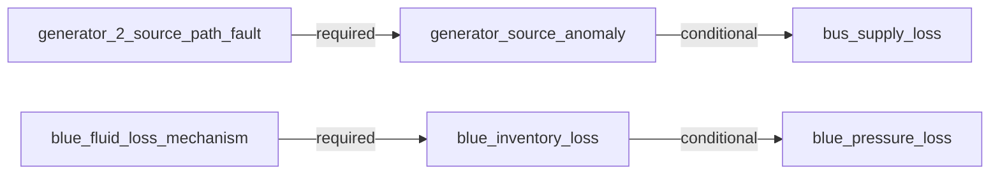

# AeroTrace causal diagnosis

Outcome: **single_compatible_candidate**.
Public observations: 33; method: `dependency_compatibility_with_temporal_constraints`.

Explanation scope: {"closed": true, "end_sample_index": 27, "epoch": 0, "incident_id": "I0001", "kind": "last_observed_incident", "reference_sample_index": 16, "start_sample_index": 17}

Compatible model candidates: generator_2_source_path_fault
Plausible candidates awaiting evidence: none

A surviving model configuration does not establish a unique physical cause or probability.

**What could reduce uncertainty.**
No additional selected discriminator is identified for the surviving configuration.

**Executable dependency model.** Conditional links permit retained downstream supply.

**Confirmed incident degradation.**
- Generator-2 source-output degradation was observed in this incident. Bus observations are separate; source loss does not establish total downstream supply loss. Evidence: generator_2_voltage at sample 18: 0.0 V; generator_2_voltage at sample 25: 0.0 V.

**Current observed impact.**
No selected confirmed impact in this scope; this is not a whole-aircraft health statement.

**Hypothesis: No selected mechanism currently required** (`selected_reference`).
Status: `contradicted`.
Supporting evidence:
- blue inventory loss: Usable observation agrees with the executable dependency prediction. Evidence: blue_quantity at sample 27: 8.0 raw model quantity.
- bus supply loss: Usable observation agrees with the executable dependency prediction. Evidence: ac_bus_2 at sample 27: 115.000667 V.
- blue pressure loss: Usable observation agrees with the executable dependency prediction. Evidence: blue_pressure at sample 27: 3000.0 psi.
Contradicting evidence:
- generator source anomaly: This observed effect is not explained by the candidate's selected dependency paths. Evidence: generator_2_voltage at sample 18: 0.0 V; generator_2_voltage at sample 25: 0.0 V.
Predicted consequences:
- generator source anomaly: This observed effect is not explained by the candidate's selected dependency paths. Evidence: generator_2_voltage at sample 18: 0.0 V; generator_2_voltage at sample 25: 0.0 V.
- blue inventory loss: Usable observation agrees with the executable dependency prediction. Evidence: blue_quantity at sample 27: 8.0 raw model quantity.
- bus supply loss: Usable observation agrees with the executable dependency prediction. Evidence: ac_bus_2 at sample 27: 115.000667 V.
- blue pressure loss: Usable observation agrees with the executable dependency prediction. Evidence: blue_pressure at sample 27: 3000.0 psi.
Possible dependency paths:
- None recorded for this candidate.
Missing evidence:
- None recorded for this candidate.
Alternative compatible candidates: generator_2_source_path_fault

**Hypothesis: Generator 2 source-path fault** (`generator_2_source_path_fault`).
Status: `compatible`.
Supporting evidence:
- generator source anomaly: Usable observation agrees with the executable dependency prediction. Evidence: generator_2_voltage at sample 18: 0.0 V; generator_2_voltage at sample 25: 0.0 V.
- blue inventory loss: Usable observation agrees with the executable dependency prediction. Evidence: blue_quantity at sample 27: 8.0 raw model quantity.
- bus supply loss: This downstream effect is conditional; either retained or degraded output is compatible. Evidence: ac_bus_2 at sample 27: 115.000667 V.
- blue pressure loss: Usable observation agrees with the executable dependency prediction. Evidence: blue_pressure at sample 27: 3000.0 psi.
Contradicting evidence:
- None recorded for this candidate.
Predicted consequences:
- generator source anomaly: Usable observation agrees with the executable dependency prediction. Evidence: generator_2_voltage at sample 18: 0.0 V; generator_2_voltage at sample 25: 0.0 V.
- blue inventory loss: Usable observation agrees with the executable dependency prediction. Evidence: blue_quantity at sample 27: 8.0 raw model quantity.
- bus supply loss: This downstream effect is conditional; either retained or degraded output is compatible. Evidence: ac_bus_2 at sample 27: 115.000667 V.
- blue pressure loss: Usable observation agrees with the executable dependency prediction. Evidence: blue_pressure at sample 27: 3000.0 psi.
Possible dependency paths:
- generator_2_source_path_fault -> generator_source_anomaly (required). The selected source-path mechanism predicts abnormal generator-2 output.
- generator_2_source_path_fault -> generator_source_anomaly -> bus_supply_loss (conditional). The selected source-path mechanism predicts abnormal generator-2 output. Downstream supply can be lost if alternate supply is unavailable; retained bus voltage is compatible and does not identify its supply route.
Missing evidence:
- None recorded for this candidate.
Alternative compatible candidates: none

**Hypothesis: Blue fluid-inventory-loss analogue** (`blue_inventory_loss`).
Status: `contradicted`.
Supporting evidence:
- bus supply loss: Usable observation agrees with the executable dependency prediction. Evidence: ac_bus_2 at sample 27: 115.000667 V.
- blue pressure loss: This downstream effect is conditional; either retained or degraded output is compatible. Evidence: blue_pressure at sample 27: 3000.0 psi.
Contradicting evidence:
- generator source anomaly: This observed effect is not explained by the candidate's selected dependency paths. Evidence: generator_2_voltage at sample 18: 0.0 V; generator_2_voltage at sample 25: 0.0 V.
- blue inventory loss: The candidate requires this effect, but it is not observed in the supplied incident scope. Evidence: blue_quantity at sample 27: 8.0 raw model quantity.
Predicted consequences:
- generator source anomaly: This observed effect is not explained by the candidate's selected dependency paths. Evidence: generator_2_voltage at sample 18: 0.0 V; generator_2_voltage at sample 25: 0.0 V.
- blue inventory loss: The candidate requires this effect, but it is not observed in the supplied incident scope. Evidence: blue_quantity at sample 27: 8.0 raw model quantity.
- bus supply loss: Usable observation agrees with the executable dependency prediction. Evidence: ac_bus_2 at sample 27: 115.000667 V.
- blue pressure loss: This downstream effect is conditional; either retained or degraded output is compatible. Evidence: blue_pressure at sample 27: 3000.0 psi.
Possible dependency paths:
- blue_fluid_loss_mechanism -> blue_inventory_loss (required). The selected fluid-loss analogue predicts inventory decline from an observed reference.
- blue_fluid_loss_mechanism -> blue_inventory_loss -> blue_pressure_loss (conditional). The selected fluid-loss analogue predicts inventory decline from an observed reference. Pressure can degrade as inventory/supply becomes insufficient; early retained pressure and subsequent restoration lag are allowed. No exact delay is assumed.
Missing evidence:
- None recorded for this candidate.
Alternative compatible candidates: generator_2_source_path_fault

**Hypothesis: Independent source-path and blue inventory-loss mechanisms** (`independent_pair`).
Status: `contradicted`.
Supporting evidence:
- generator source anomaly: Usable observation agrees with the executable dependency prediction. Evidence: generator_2_voltage at sample 18: 0.0 V; generator_2_voltage at sample 25: 0.0 V.
- bus supply loss: This downstream effect is conditional; either retained or degraded output is compatible. Evidence: ac_bus_2 at sample 27: 115.000667 V.
- blue pressure loss: This downstream effect is conditional; either retained or degraded output is compatible. Evidence: blue_pressure at sample 27: 3000.0 psi.
Contradicting evidence:
- blue inventory loss: The candidate requires this effect, but it is not observed in the supplied incident scope. Evidence: blue_quantity at sample 27: 8.0 raw model quantity.
Predicted consequences:
- generator source anomaly: Usable observation agrees with the executable dependency prediction. Evidence: generator_2_voltage at sample 18: 0.0 V; generator_2_voltage at sample 25: 0.0 V.
- blue inventory loss: The candidate requires this effect, but it is not observed in the supplied incident scope. Evidence: blue_quantity at sample 27: 8.0 raw model quantity.
- bus supply loss: This downstream effect is conditional; either retained or degraded output is compatible. Evidence: ac_bus_2 at sample 27: 115.000667 V.
- blue pressure loss: This downstream effect is conditional; either retained or degraded output is compatible. Evidence: blue_pressure at sample 27: 3000.0 psi.
Possible dependency paths:
- generator_2_source_path_fault -> generator_source_anomaly (required). The selected source-path mechanism predicts abnormal generator-2 output.
- generator_2_source_path_fault -> generator_source_anomaly -> bus_supply_loss (conditional). The selected source-path mechanism predicts abnormal generator-2 output. Downstream supply can be lost if alternate supply is unavailable; retained bus voltage is compatible and does not identify its supply route.
- blue_fluid_loss_mechanism -> blue_inventory_loss (required). The selected fluid-loss analogue predicts inventory decline from an observed reference.
- blue_fluid_loss_mechanism -> blue_inventory_loss -> blue_pressure_loss (conditional). The selected fluid-loss analogue predicts inventory decline from an observed reference. Pressure can degrade as inventory/supply becomes insufficient; early retained pressure and subsequent restoration lag are allowed. No exact delay is assumed.
Missing evidence:
- None recorded for this candidate.
Alternative compatible candidates: generator_2_source_path_fault

**Hypothesis: One grouped event affecting both selected mechanisms** (`grouped_joint_event`).
Status: `contradicted`.
Supporting evidence:
- generator source anomaly: Usable observation agrees with the executable dependency prediction. Evidence: generator_2_voltage at sample 18: 0.0 V; generator_2_voltage at sample 25: 0.0 V.
- bus supply loss: This downstream effect is conditional; either retained or degraded output is compatible. Evidence: ac_bus_2 at sample 27: 115.000667 V.
- blue pressure loss: This downstream effect is conditional; either retained or degraded output is compatible. Evidence: blue_pressure at sample 27: 3000.0 psi.
Contradicting evidence:
- blue inventory loss: The candidate requires this effect, but it is not observed in the supplied incident scope. Evidence: blue_quantity at sample 27: 8.0 raw model quantity.
Predicted consequences:
- generator source anomaly: Usable observation agrees with the executable dependency prediction. Evidence: generator_2_voltage at sample 18: 0.0 V; generator_2_voltage at sample 25: 0.0 V.
- blue inventory loss: The candidate requires this effect, but it is not observed in the supplied incident scope. Evidence: blue_quantity at sample 27: 8.0 raw model quantity.
- bus supply loss: This downstream effect is conditional; either retained or degraded output is compatible. Evidence: ac_bus_2 at sample 27: 115.000667 V.
- blue pressure loss: This downstream effect is conditional; either retained or degraded output is compatible. Evidence: blue_pressure at sample 27: 3000.0 psi.
Possible dependency paths:
- generator_2_source_path_fault -> generator_source_anomaly (required). The selected source-path mechanism predicts abnormal generator-2 output.
- generator_2_source_path_fault -> generator_source_anomaly -> bus_supply_loss (conditional). The selected source-path mechanism predicts abnormal generator-2 output. Downstream supply can be lost if alternate supply is unavailable; retained bus voltage is compatible and does not identify its supply route.
- blue_fluid_loss_mechanism -> blue_inventory_loss (required). The selected fluid-loss analogue predicts inventory decline from an observed reference.
- blue_fluid_loss_mechanism -> blue_inventory_loss -> blue_pressure_loss (conditional). The selected fluid-loss analogue predicts inventory decline from an observed reference. Pressure can degrade as inventory/supply becomes insufficient; early retained pressure and subsequent restoration lag are allowed. No exact delay is assumed.
Missing evidence:
- None recorded for this candidate.
Alternative compatible candidates: generator_2_source_path_fault

**Diagnostic timeline.**

| Sample | Epoch | Simulator seconds | Status | Compatible candidates |
|---:|---:|---:|---|---|
| 0 | 0 | 351.716667 | insufficient_observations |  |
| 1 | 0 | 352.725 | no_selected_anomaly | selected_reference |
| 2 | 0 | 353.733333 | no_selected_anomaly | selected_reference |
| 3 | 0 | 354.725 | no_selected_anomaly | selected_reference |
| 4 | 0 | 355.733333 | no_selected_anomaly | selected_reference |
| 5 | 0 | 356.725 | no_selected_anomaly | selected_reference |
| 6 | 0 | 357.733333 | no_selected_anomaly | selected_reference |
| 7 | 0 | 358.725 | no_selected_anomaly | selected_reference |
| 8 | 0 | 359.741667 | no_selected_anomaly | selected_reference |
| 9 | 0 | 360.741667 | no_selected_anomaly | selected_reference |
| 10 | 0 | 361.733333 | no_selected_anomaly | selected_reference |
| 11 | 0 | 362.733333 | no_selected_anomaly | selected_reference |
| 12 | 0 | 363.741667 | no_selected_anomaly | selected_reference |
| 13 | 0 | 364.733333 | no_selected_anomaly | selected_reference |
| 14 | 0 | 365.741667 | no_selected_anomaly | selected_reference |
| 15 | 0 | 366.741667 | no_selected_anomaly | selected_reference |
| 16 | 0 | 367.741667 | no_selected_anomaly | selected_reference |
| 17 | 0 | 368.158333 | insufficient_observations |  |
| 18 | 0 | 369.15 | single_compatible_candidate | generator_2_source_path_fault |
| 19 | 0 | 370.158333 | single_compatible_candidate | generator_2_source_path_fault |
| 20 | 0 | 371.158333 | single_compatible_candidate | generator_2_source_path_fault |
| 21 | 0 | 372.158333 | single_compatible_candidate | generator_2_source_path_fault |
| 22 | 0 | 373.158333 | single_compatible_candidate | generator_2_source_path_fault |
| 23 | 0 | 374.158333 | single_compatible_candidate | generator_2_source_path_fault |
| 24 | 0 | 375.166667 | single_compatible_candidate | generator_2_source_path_fault |
| 25 | 0 | 376.158333 | single_compatible_candidate | generator_2_source_path_fault |
| 26 | 0 | 376.541667 | single_compatible_candidate | generator_2_source_path_fault |
| 27 | 0 | 377.541667 | single_compatible_candidate | generator_2_source_path_fault |
| 28 | 0 | 378.533333 | single_compatible_candidate | generator_2_source_path_fault |
| 29 | 0 | 379.55 | single_compatible_candidate | generator_2_source_path_fault |
| 30 | 0 | 380.558333 | single_compatible_candidate | generator_2_source_path_fault |
| 31 | 0 | 381.541667 | single_compatible_candidate | generator_2_source_path_fault |
| 32 | 0 | 382.541667 | single_compatible_candidate | generator_2_source_path_fault |

**Limits.**
- Five bounded candidate configurations reuse two verified native mechanisms; this is not complete aircraft diagnosis.
- A compatible model candidate is not a uniquely identified physical component failure or calibrated probability.
- The grouped joint-event and independent pair have identical observable predictions in this model; no available observation is invented to distinguish them.
- Incident-history hypotheses and confirmed incident degradation remain separate from current recovered or unavailable readings.
- The simulator and diagnostic model are related engineering abstractions, not independent real-aircraft validation.
- Temporal constraints are qualitative model assumptions; native depletion rates and exact propagation delays are not fitted signatures.
- The first offline path uses repeated prefix analysis; computation and memory suitability for a live display require separate measurement.
