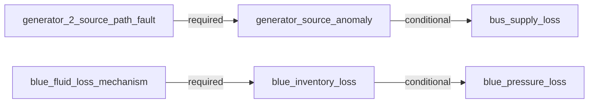

# AeroTrace causal diagnosis

Outcome: **single_compatible_candidate**.
Public observations: 80; method: `dependency_compatibility_with_temporal_constraints`.

Explanation scope: {"closed": true, "end_sample_index": 76, "epoch": 0, "incident_id": "I0001", "kind": "last_observed_incident", "reference_sample_index": 17, "start_sample_index": 18}

Compatible model candidates: blue_inventory_loss
Plausible candidates awaiting evidence: none

A surviving model configuration does not establish a unique physical cause or probability.

**What could reduce uncertainty.**
No additional selected discriminator is identified for the surviving configuration.

**Executable dependency model.** Conditional links permit retained downstream supply.

**Confirmed incident degradation.**
- Blue inventory depletion was observed in this incident. Raw inventory units and actuator capability remain unresolved; pressure is assessed separately. Evidence: blue_quantity at sample 19: 7.45 raw model quantity; blue_quantity at sample 69: 0.0 raw model quantity.
- Blue pressure degradation was observed in this incident. Pressure degradation does not establish total controllability or manual-control force. Evidence: blue_pressure at sample 49: 2370.0 psi; blue_pressure at sample 74: 2100.0 psi.

**Current observed impact.**
No selected confirmed impact in this scope; this is not a whole-aircraft health statement.

**Hypothesis: No selected mechanism currently required** (`selected_reference`).
Status: `contradicted`.
Supporting evidence:
- generator source anomaly: Usable observation agrees with the executable dependency prediction. Evidence: generator_2_voltage at sample 76: 115.000109 V.
- bus supply loss: Usable observation agrees with the executable dependency prediction. Evidence: ac_bus_2 at sample 76: 115.000794 V.
Contradicting evidence:
- blue inventory loss: This observed effect is not explained by the candidate's selected dependency paths. Evidence: blue_quantity at sample 19: 7.45 raw model quantity; blue_quantity at sample 69: 0.0 raw model quantity.
- blue pressure loss: This observed effect is not explained by the candidate's selected dependency paths. Evidence: blue_pressure at sample 49: 2370.0 psi; blue_pressure at sample 74: 2100.0 psi.
Predicted consequences:
- generator source anomaly: Usable observation agrees with the executable dependency prediction. Evidence: generator_2_voltage at sample 76: 115.000109 V.
- blue inventory loss: This observed effect is not explained by the candidate's selected dependency paths. Evidence: blue_quantity at sample 19: 7.45 raw model quantity; blue_quantity at sample 69: 0.0 raw model quantity.
- bus supply loss: Usable observation agrees with the executable dependency prediction. Evidence: ac_bus_2 at sample 76: 115.000794 V.
- blue pressure loss: This observed effect is not explained by the candidate's selected dependency paths. Evidence: blue_pressure at sample 49: 2370.0 psi; blue_pressure at sample 74: 2100.0 psi.
Possible dependency paths:
- None recorded for this candidate.
Missing evidence:
- None recorded for this candidate.
Alternative compatible candidates: blue_inventory_loss

**Hypothesis: Generator 2 source-path fault** (`generator_2_source_path_fault`).
Status: `contradicted`.
Supporting evidence:
- bus supply loss: This downstream effect is conditional; either retained or degraded output is compatible. Evidence: ac_bus_2 at sample 76: 115.000794 V.
Contradicting evidence:
- generator source anomaly: The candidate requires this effect, but it is not observed in the supplied incident scope. Evidence: generator_2_voltage at sample 76: 115.000109 V.
- blue inventory loss: This observed effect is not explained by the candidate's selected dependency paths. Evidence: blue_quantity at sample 19: 7.45 raw model quantity; blue_quantity at sample 69: 0.0 raw model quantity.
- blue pressure loss: This observed effect is not explained by the candidate's selected dependency paths. Evidence: blue_pressure at sample 49: 2370.0 psi; blue_pressure at sample 74: 2100.0 psi.
Predicted consequences:
- generator source anomaly: The candidate requires this effect, but it is not observed in the supplied incident scope. Evidence: generator_2_voltage at sample 76: 115.000109 V.
- blue inventory loss: This observed effect is not explained by the candidate's selected dependency paths. Evidence: blue_quantity at sample 19: 7.45 raw model quantity; blue_quantity at sample 69: 0.0 raw model quantity.
- bus supply loss: This downstream effect is conditional; either retained or degraded output is compatible. Evidence: ac_bus_2 at sample 76: 115.000794 V.
- blue pressure loss: This observed effect is not explained by the candidate's selected dependency paths. Evidence: blue_pressure at sample 49: 2370.0 psi; blue_pressure at sample 74: 2100.0 psi.
Possible dependency paths:
- generator_2_source_path_fault -> generator_source_anomaly (required). The selected source-path mechanism predicts abnormal generator-2 output.
- generator_2_source_path_fault -> generator_source_anomaly -> bus_supply_loss (conditional). The selected source-path mechanism predicts abnormal generator-2 output. Downstream supply can be lost if alternate supply is unavailable; retained bus voltage is compatible and does not identify its supply route.
Missing evidence:
- None recorded for this candidate.
Alternative compatible candidates: blue_inventory_loss

**Hypothesis: Blue fluid-inventory-loss analogue** (`blue_inventory_loss`).
Status: `compatible`.
Supporting evidence:
- generator source anomaly: Usable observation agrees with the executable dependency prediction. Evidence: generator_2_voltage at sample 76: 115.000109 V.
- blue inventory loss: Usable observation agrees with the executable dependency prediction. Evidence: blue_quantity at sample 19: 7.45 raw model quantity; blue_quantity at sample 69: 0.0 raw model quantity.
- bus supply loss: Usable observation agrees with the executable dependency prediction. Evidence: ac_bus_2 at sample 76: 115.000794 V.
- blue pressure loss: This downstream effect is conditional; either retained or degraded output is compatible. Evidence: blue_pressure at sample 49: 2370.0 psi; blue_pressure at sample 74: 2100.0 psi.
- The observed inventory-loss bracket precedes the pressure-loss bracket; this supports the qualitative selected depletion path, not an exact physical delay. Evidence: blue_quantity at sample 19: 7.45 raw model quantity; blue_pressure at sample 49: 2370.0 psi.
Contradicting evidence:
- None recorded for this candidate.
Predicted consequences:
- generator source anomaly: Usable observation agrees with the executable dependency prediction. Evidence: generator_2_voltage at sample 76: 115.000109 V.
- blue inventory loss: Usable observation agrees with the executable dependency prediction. Evidence: blue_quantity at sample 19: 7.45 raw model quantity; blue_quantity at sample 69: 0.0 raw model quantity.
- bus supply loss: Usable observation agrees with the executable dependency prediction. Evidence: ac_bus_2 at sample 76: 115.000794 V.
- blue pressure loss: This downstream effect is conditional; either retained or degraded output is compatible. Evidence: blue_pressure at sample 49: 2370.0 psi; blue_pressure at sample 74: 2100.0 psi.
Possible dependency paths:
- blue_fluid_loss_mechanism -> blue_inventory_loss (required). The selected fluid-loss analogue predicts inventory decline from an observed reference.
- blue_fluid_loss_mechanism -> blue_inventory_loss -> blue_pressure_loss (conditional). The selected fluid-loss analogue predicts inventory decline from an observed reference. Pressure can degrade as inventory/supply becomes insufficient; early retained pressure and subsequent restoration lag are allowed. No exact delay is assumed.
Missing evidence:
- None recorded for this candidate.
Alternative compatible candidates: none

**Hypothesis: Independent source-path and blue inventory-loss mechanisms** (`independent_pair`).
Status: `contradicted`.
Supporting evidence:
- blue inventory loss: Usable observation agrees with the executable dependency prediction. Evidence: blue_quantity at sample 19: 7.45 raw model quantity; blue_quantity at sample 69: 0.0 raw model quantity.
- bus supply loss: This downstream effect is conditional; either retained or degraded output is compatible. Evidence: ac_bus_2 at sample 76: 115.000794 V.
- blue pressure loss: This downstream effect is conditional; either retained or degraded output is compatible. Evidence: blue_pressure at sample 49: 2370.0 psi; blue_pressure at sample 74: 2100.0 psi.
- The observed inventory-loss bracket precedes the pressure-loss bracket; this supports the qualitative selected depletion path, not an exact physical delay. Evidence: blue_quantity at sample 19: 7.45 raw model quantity; blue_pressure at sample 49: 2370.0 psi.
Contradicting evidence:
- generator source anomaly: The candidate requires this effect, but it is not observed in the supplied incident scope. Evidence: generator_2_voltage at sample 76: 115.000109 V.
Predicted consequences:
- generator source anomaly: The candidate requires this effect, but it is not observed in the supplied incident scope. Evidence: generator_2_voltage at sample 76: 115.000109 V.
- blue inventory loss: Usable observation agrees with the executable dependency prediction. Evidence: blue_quantity at sample 19: 7.45 raw model quantity; blue_quantity at sample 69: 0.0 raw model quantity.
- bus supply loss: This downstream effect is conditional; either retained or degraded output is compatible. Evidence: ac_bus_2 at sample 76: 115.000794 V.
- blue pressure loss: This downstream effect is conditional; either retained or degraded output is compatible. Evidence: blue_pressure at sample 49: 2370.0 psi; blue_pressure at sample 74: 2100.0 psi.
Possible dependency paths:
- generator_2_source_path_fault -> generator_source_anomaly (required). The selected source-path mechanism predicts abnormal generator-2 output.
- generator_2_source_path_fault -> generator_source_anomaly -> bus_supply_loss (conditional). The selected source-path mechanism predicts abnormal generator-2 output. Downstream supply can be lost if alternate supply is unavailable; retained bus voltage is compatible and does not identify its supply route.
- blue_fluid_loss_mechanism -> blue_inventory_loss (required). The selected fluid-loss analogue predicts inventory decline from an observed reference.
- blue_fluid_loss_mechanism -> blue_inventory_loss -> blue_pressure_loss (conditional). The selected fluid-loss analogue predicts inventory decline from an observed reference. Pressure can degrade as inventory/supply becomes insufficient; early retained pressure and subsequent restoration lag are allowed. No exact delay is assumed.
Missing evidence:
- None recorded for this candidate.
Alternative compatible candidates: blue_inventory_loss

**Hypothesis: One grouped event affecting both selected mechanisms** (`grouped_joint_event`).
Status: `contradicted`.
Supporting evidence:
- blue inventory loss: Usable observation agrees with the executable dependency prediction. Evidence: blue_quantity at sample 19: 7.45 raw model quantity; blue_quantity at sample 69: 0.0 raw model quantity.
- bus supply loss: This downstream effect is conditional; either retained or degraded output is compatible. Evidence: ac_bus_2 at sample 76: 115.000794 V.
- blue pressure loss: This downstream effect is conditional; either retained or degraded output is compatible. Evidence: blue_pressure at sample 49: 2370.0 psi; blue_pressure at sample 74: 2100.0 psi.
- The observed inventory-loss bracket precedes the pressure-loss bracket; this supports the qualitative selected depletion path, not an exact physical delay. Evidence: blue_quantity at sample 19: 7.45 raw model quantity; blue_pressure at sample 49: 2370.0 psi.
Contradicting evidence:
- generator source anomaly: The candidate requires this effect, but it is not observed in the supplied incident scope. Evidence: generator_2_voltage at sample 76: 115.000109 V.
Predicted consequences:
- generator source anomaly: The candidate requires this effect, but it is not observed in the supplied incident scope. Evidence: generator_2_voltage at sample 76: 115.000109 V.
- blue inventory loss: Usable observation agrees with the executable dependency prediction. Evidence: blue_quantity at sample 19: 7.45 raw model quantity; blue_quantity at sample 69: 0.0 raw model quantity.
- bus supply loss: This downstream effect is conditional; either retained or degraded output is compatible. Evidence: ac_bus_2 at sample 76: 115.000794 V.
- blue pressure loss: This downstream effect is conditional; either retained or degraded output is compatible. Evidence: blue_pressure at sample 49: 2370.0 psi; blue_pressure at sample 74: 2100.0 psi.
Possible dependency paths:
- generator_2_source_path_fault -> generator_source_anomaly (required). The selected source-path mechanism predicts abnormal generator-2 output.
- generator_2_source_path_fault -> generator_source_anomaly -> bus_supply_loss (conditional). The selected source-path mechanism predicts abnormal generator-2 output. Downstream supply can be lost if alternate supply is unavailable; retained bus voltage is compatible and does not identify its supply route.
- blue_fluid_loss_mechanism -> blue_inventory_loss (required). The selected fluid-loss analogue predicts inventory decline from an observed reference.
- blue_fluid_loss_mechanism -> blue_inventory_loss -> blue_pressure_loss (conditional). The selected fluid-loss analogue predicts inventory decline from an observed reference. Pressure can degrade as inventory/supply becomes insufficient; early retained pressure and subsequent restoration lag are allowed. No exact delay is assumed.
Missing evidence:
- None recorded for this candidate.
Alternative compatible candidates: blue_inventory_loss

**Diagnostic timeline.**

| Sample | Epoch | Simulator seconds | Status | Compatible candidates |
|---:|---:|---:|---|---|
| 0 | 0 | 474.975 | insufficient_observations |  |
| 1 | 0 | 475.991667 | no_selected_anomaly | selected_reference |
| 2 | 0 | 476.983333 | no_selected_anomaly | selected_reference |
| 3 | 0 | 478.025 | no_selected_anomaly | selected_reference |
| 4 | 0 | 478.991667 | no_selected_anomaly | selected_reference |
| 5 | 0 | 479.991667 | no_selected_anomaly | selected_reference |
| 6 | 0 | 480.991667 | no_selected_anomaly | selected_reference |
| 7 | 0 | 481.991667 | no_selected_anomaly | selected_reference |
| 8 | 0 | 482.991667 | no_selected_anomaly | selected_reference |
| 9 | 0 | 483.991667 | no_selected_anomaly | selected_reference |
| 10 | 0 | 485.0 | no_selected_anomaly | selected_reference |
| 11 | 0 | 485.991667 | no_selected_anomaly | selected_reference |
| 12 | 0 | 486.991667 | no_selected_anomaly | selected_reference |
| 13 | 0 | 488.008333 | no_selected_anomaly | selected_reference |
| 14 | 0 | 488.991667 | no_selected_anomaly | selected_reference |
| 15 | 0 | 490.0 | no_selected_anomaly | selected_reference |
| 16 | 0 | 491.0 | no_selected_anomaly | selected_reference |
| 17 | 0 | 491.45 | no_selected_anomaly | selected_reference |
| 18 | 0 | 492.433333 | insufficient_observations |  |
| 19 | 0 | 493.45 | single_compatible_candidate | blue_inventory_loss |
| 20 | 0 | 494.45 | single_compatible_candidate | blue_inventory_loss |
| 21 | 0 | 495.458333 | single_compatible_candidate | blue_inventory_loss |
| 22 | 0 | 496.458333 | single_compatible_candidate | blue_inventory_loss |
| 23 | 0 | 497.45 | single_compatible_candidate | blue_inventory_loss |
| 24 | 0 | 498.45 | single_compatible_candidate | blue_inventory_loss |
| 25 | 0 | 499.441667 | single_compatible_candidate | blue_inventory_loss |
| 26 | 0 | 500.458333 | single_compatible_candidate | blue_inventory_loss |
| 27 | 0 | 501.45 | single_compatible_candidate | blue_inventory_loss |
| 28 | 0 | 502.45 | single_compatible_candidate | blue_inventory_loss |
| 29 | 0 | 503.45 | single_compatible_candidate | blue_inventory_loss |
| 30 | 0 | 504.441667 | single_compatible_candidate | blue_inventory_loss |
| 31 | 0 | 505.45 | single_compatible_candidate | blue_inventory_loss |
| 32 | 0 | 506.458333 | single_compatible_candidate | blue_inventory_loss |
| 33 | 0 | 507.458333 | single_compatible_candidate | blue_inventory_loss |
| 34 | 0 | 508.45 | single_compatible_candidate | blue_inventory_loss |
| 35 | 0 | 509.458333 | single_compatible_candidate | blue_inventory_loss |
| 36 | 0 | 510.45 | single_compatible_candidate | blue_inventory_loss |
| 37 | 0 | 511.45 | single_compatible_candidate | blue_inventory_loss |
| 38 | 0 | 512.466667 | single_compatible_candidate | blue_inventory_loss |
| 39 | 0 | 513.45 | single_compatible_candidate | blue_inventory_loss |
| 40 | 0 | 514.458333 | single_compatible_candidate | blue_inventory_loss |
| 41 | 0 | 515.466667 | single_compatible_candidate | blue_inventory_loss |
| 42 | 0 | 516.458333 | single_compatible_candidate | blue_inventory_loss |
| 43 | 0 | 517.45 | single_compatible_candidate | blue_inventory_loss |
| 44 | 0 | 518.466667 | single_compatible_candidate | blue_inventory_loss |
| 45 | 0 | 519.458333 | single_compatible_candidate | blue_inventory_loss |
| 46 | 0 | 520.466667 | single_compatible_candidate | blue_inventory_loss |
| 47 | 0 | 521.475 | single_compatible_candidate | blue_inventory_loss |
| 48 | 0 | 522.466667 | single_compatible_candidate | blue_inventory_loss |
| 49 | 0 | 523.466667 | single_compatible_candidate | blue_inventory_loss |
| 50 | 0 | 524.466667 | single_compatible_candidate | blue_inventory_loss |
| 51 | 0 | 525.458333 | single_compatible_candidate | blue_inventory_loss |
| 52 | 0 | 526.466667 | single_compatible_candidate | blue_inventory_loss |
| 53 | 0 | 527.45 | single_compatible_candidate | blue_inventory_loss |
| 54 | 0 | 528.45 | single_compatible_candidate | blue_inventory_loss |
| 55 | 0 | 529.458333 | single_compatible_candidate | blue_inventory_loss |
| 56 | 0 | 530.483333 | single_compatible_candidate | blue_inventory_loss |
| 57 | 0 | 531.466667 | single_compatible_candidate | blue_inventory_loss |
| 58 | 0 | 532.466667 | single_compatible_candidate | blue_inventory_loss |
| 59 | 0 | 533.466667 | single_compatible_candidate | blue_inventory_loss |
| 60 | 0 | 534.475 | single_compatible_candidate | blue_inventory_loss |
| 61 | 0 | 535.458333 | single_compatible_candidate | blue_inventory_loss |
| 62 | 0 | 536.475 | single_compatible_candidate | blue_inventory_loss |
| 63 | 0 | 537.466667 | single_compatible_candidate | blue_inventory_loss |
| 64 | 0 | 538.466667 | single_compatible_candidate | blue_inventory_loss |
| 65 | 0 | 539.458333 | single_compatible_candidate | blue_inventory_loss |
| 66 | 0 | 540.466667 | single_compatible_candidate | blue_inventory_loss |
| 67 | 0 | 541.475 | single_compatible_candidate | blue_inventory_loss |
| 68 | 0 | 542.483333 | single_compatible_candidate | blue_inventory_loss |
| 69 | 0 | 543.475 | single_compatible_candidate | blue_inventory_loss |
| 70 | 0 | 543.883333 | single_compatible_candidate | blue_inventory_loss |
| 71 | 0 | 544.875 | single_compatible_candidate | blue_inventory_loss |
| 72 | 0 | 545.875 | single_compatible_candidate | blue_inventory_loss |
| 73 | 0 | 546.875 | single_compatible_candidate | blue_inventory_loss |
| 74 | 0 | 547.883333 | single_compatible_candidate | blue_inventory_loss |
| 75 | 0 | 548.875 | single_compatible_candidate | blue_inventory_loss |
| 76 | 0 | 549.875 | single_compatible_candidate | blue_inventory_loss |
| 77 | 0 | 550.883333 | single_compatible_candidate | blue_inventory_loss |
| 78 | 0 | 551.875 | single_compatible_candidate | blue_inventory_loss |
| 79 | 0 | 552.875 | single_compatible_candidate | blue_inventory_loss |

**Limits.**
- Five bounded candidate configurations reuse two verified native mechanisms; this is not complete aircraft diagnosis.
- A compatible model candidate is not a uniquely identified physical component failure or calibrated probability.
- The grouped joint-event and independent pair have identical observable predictions in this model; no available observation is invented to distinguish them.
- Incident-history hypotheses and confirmed incident degradation remain separate from current recovered or unavailable readings.
- The simulator and diagnostic model are related engineering abstractions, not independent real-aircraft validation.
- Temporal constraints are qualitative model assumptions; native depletion rates and exact propagation delays are not fitted signatures.
- The first offline path uses repeated prefix analysis; computation and memory suitability for a live display require separate measurement.
