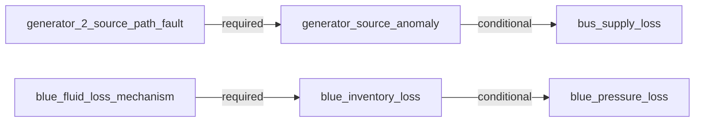

# AeroTrace causal diagnosis

Outcome: **causal_ambiguity**.
Public observations: 81; method: `dependency_compatibility_with_temporal_constraints`.

Explanation scope: {"closed": true, "end_sample_index": 77, "epoch": 0, "incident_id": "I0001", "kind": "last_observed_incident", "reference_sample_index": 17, "start_sample_index": 18}

Compatible model candidates: independent_pair, grouped_joint_event
Plausible candidates awaiting evidence: none

A surviving model configuration does not establish a unique physical cause or probability.

**What could reduce uncertainty.**
- Both candidates have identical predicted effects and temporal rules across the selected observation model. No available modeled measurement can establish their initiating history.

**Executable dependency model.** Conditional links permit retained downstream supply.

**Confirmed incident degradation.**
- Generator-2 source-output degradation was observed in this incident. Bus observations are separate; source loss does not establish total downstream supply loss. Evidence: generator_2_voltage at sample 19: 0.0 V; generator_2_voltage at sample 70: 0.0 V.
- Blue inventory depletion was observed in this incident. Raw inventory units and actuator capability remain unresolved; pressure is assessed separately. Evidence: blue_quantity at sample 20: 7.466667 raw model quantity; blue_quantity at sample 70: 0.0 raw model quantity.
- Blue pressure degradation was observed in this incident. Pressure degradation does not establish total controllability or manual-control force. Evidence: blue_pressure at sample 50: 2380.0 psi; blue_pressure at sample 75: 2200.0 psi.

**Current observed impact.**
No selected confirmed impact in this scope; this is not a whole-aircraft health statement.

**Hypothesis: No selected mechanism currently required** (`selected_reference`).
Status: `contradicted`.
Supporting evidence:
- bus supply loss: Usable observation agrees with the executable dependency prediction. Evidence: ac_bus_2 at sample 77: 115.000796 V.
Contradicting evidence:
- generator source anomaly: This observed effect is not explained by the candidate's selected dependency paths. Evidence: generator_2_voltage at sample 19: 0.0 V; generator_2_voltage at sample 70: 0.0 V.
- blue inventory loss: This observed effect is not explained by the candidate's selected dependency paths. Evidence: blue_quantity at sample 20: 7.466667 raw model quantity; blue_quantity at sample 70: 0.0 raw model quantity.
- blue pressure loss: This observed effect is not explained by the candidate's selected dependency paths. Evidence: blue_pressure at sample 50: 2380.0 psi; blue_pressure at sample 75: 2200.0 psi.
Predicted consequences:
- generator source anomaly: This observed effect is not explained by the candidate's selected dependency paths. Evidence: generator_2_voltage at sample 19: 0.0 V; generator_2_voltage at sample 70: 0.0 V.
- blue inventory loss: This observed effect is not explained by the candidate's selected dependency paths. Evidence: blue_quantity at sample 20: 7.466667 raw model quantity; blue_quantity at sample 70: 0.0 raw model quantity.
- bus supply loss: Usable observation agrees with the executable dependency prediction. Evidence: ac_bus_2 at sample 77: 115.000796 V.
- blue pressure loss: This observed effect is not explained by the candidate's selected dependency paths. Evidence: blue_pressure at sample 50: 2380.0 psi; blue_pressure at sample 75: 2200.0 psi.
Possible dependency paths:
- None recorded for this candidate.
Missing evidence:
- None recorded for this candidate.
Alternative compatible candidates: independent_pair, grouped_joint_event

**Hypothesis: Generator 2 source-path fault** (`generator_2_source_path_fault`).
Status: `contradicted`.
Supporting evidence:
- generator source anomaly: Usable observation agrees with the executable dependency prediction. Evidence: generator_2_voltage at sample 19: 0.0 V; generator_2_voltage at sample 70: 0.0 V.
- bus supply loss: This downstream effect is conditional; either retained or degraded output is compatible. Evidence: ac_bus_2 at sample 77: 115.000796 V.
Contradicting evidence:
- blue inventory loss: This observed effect is not explained by the candidate's selected dependency paths. Evidence: blue_quantity at sample 20: 7.466667 raw model quantity; blue_quantity at sample 70: 0.0 raw model quantity.
- blue pressure loss: This observed effect is not explained by the candidate's selected dependency paths. Evidence: blue_pressure at sample 50: 2380.0 psi; blue_pressure at sample 75: 2200.0 psi.
Predicted consequences:
- generator source anomaly: Usable observation agrees with the executable dependency prediction. Evidence: generator_2_voltage at sample 19: 0.0 V; generator_2_voltage at sample 70: 0.0 V.
- blue inventory loss: This observed effect is not explained by the candidate's selected dependency paths. Evidence: blue_quantity at sample 20: 7.466667 raw model quantity; blue_quantity at sample 70: 0.0 raw model quantity.
- bus supply loss: This downstream effect is conditional; either retained or degraded output is compatible. Evidence: ac_bus_2 at sample 77: 115.000796 V.
- blue pressure loss: This observed effect is not explained by the candidate's selected dependency paths. Evidence: blue_pressure at sample 50: 2380.0 psi; blue_pressure at sample 75: 2200.0 psi.
Possible dependency paths:
- generator_2_source_path_fault -> generator_source_anomaly (required). The selected source-path mechanism predicts abnormal generator-2 output.
- generator_2_source_path_fault -> generator_source_anomaly -> bus_supply_loss (conditional). The selected source-path mechanism predicts abnormal generator-2 output. Downstream supply can be lost if alternate supply is unavailable; retained bus voltage is compatible and does not identify its supply route.
Missing evidence:
- None recorded for this candidate.
Alternative compatible candidates: independent_pair, grouped_joint_event

**Hypothesis: Blue fluid-inventory-loss analogue** (`blue_inventory_loss`).
Status: `contradicted`.
Supporting evidence:
- blue inventory loss: Usable observation agrees with the executable dependency prediction. Evidence: blue_quantity at sample 20: 7.466667 raw model quantity; blue_quantity at sample 70: 0.0 raw model quantity.
- bus supply loss: Usable observation agrees with the executable dependency prediction. Evidence: ac_bus_2 at sample 77: 115.000796 V.
- blue pressure loss: This downstream effect is conditional; either retained or degraded output is compatible. Evidence: blue_pressure at sample 50: 2380.0 psi; blue_pressure at sample 75: 2200.0 psi.
- The observed inventory-loss bracket precedes the pressure-loss bracket; this supports the qualitative selected depletion path, not an exact physical delay. Evidence: blue_quantity at sample 20: 7.466667 raw model quantity; blue_pressure at sample 50: 2380.0 psi.
Contradicting evidence:
- generator source anomaly: This observed effect is not explained by the candidate's selected dependency paths. Evidence: generator_2_voltage at sample 19: 0.0 V; generator_2_voltage at sample 70: 0.0 V.
Predicted consequences:
- generator source anomaly: This observed effect is not explained by the candidate's selected dependency paths. Evidence: generator_2_voltage at sample 19: 0.0 V; generator_2_voltage at sample 70: 0.0 V.
- blue inventory loss: Usable observation agrees with the executable dependency prediction. Evidence: blue_quantity at sample 20: 7.466667 raw model quantity; blue_quantity at sample 70: 0.0 raw model quantity.
- bus supply loss: Usable observation agrees with the executable dependency prediction. Evidence: ac_bus_2 at sample 77: 115.000796 V.
- blue pressure loss: This downstream effect is conditional; either retained or degraded output is compatible. Evidence: blue_pressure at sample 50: 2380.0 psi; blue_pressure at sample 75: 2200.0 psi.
Possible dependency paths:
- blue_fluid_loss_mechanism -> blue_inventory_loss (required). The selected fluid-loss analogue predicts inventory decline from an observed reference.
- blue_fluid_loss_mechanism -> blue_inventory_loss -> blue_pressure_loss (conditional). The selected fluid-loss analogue predicts inventory decline from an observed reference. Pressure can degrade as inventory/supply becomes insufficient; early retained pressure and subsequent restoration lag are allowed. No exact delay is assumed.
Missing evidence:
- None recorded for this candidate.
Alternative compatible candidates: independent_pair, grouped_joint_event

**Hypothesis: Independent source-path and blue inventory-loss mechanisms** (`independent_pair`).
Status: `compatible`.
Supporting evidence:
- generator source anomaly: Usable observation agrees with the executable dependency prediction. Evidence: generator_2_voltage at sample 19: 0.0 V; generator_2_voltage at sample 70: 0.0 V.
- blue inventory loss: Usable observation agrees with the executable dependency prediction. Evidence: blue_quantity at sample 20: 7.466667 raw model quantity; blue_quantity at sample 70: 0.0 raw model quantity.
- bus supply loss: This downstream effect is conditional; either retained or degraded output is compatible. Evidence: ac_bus_2 at sample 77: 115.000796 V.
- blue pressure loss: This downstream effect is conditional; either retained or degraded output is compatible. Evidence: blue_pressure at sample 50: 2380.0 psi; blue_pressure at sample 75: 2200.0 psi.
- The observed inventory-loss bracket precedes the pressure-loss bracket; this supports the qualitative selected depletion path, not an exact physical delay. Evidence: blue_quantity at sample 20: 7.466667 raw model quantity; blue_pressure at sample 50: 2380.0 psi.
Contradicting evidence:
- None recorded for this candidate.
Predicted consequences:
- generator source anomaly: Usable observation agrees with the executable dependency prediction. Evidence: generator_2_voltage at sample 19: 0.0 V; generator_2_voltage at sample 70: 0.0 V.
- blue inventory loss: Usable observation agrees with the executable dependency prediction. Evidence: blue_quantity at sample 20: 7.466667 raw model quantity; blue_quantity at sample 70: 0.0 raw model quantity.
- bus supply loss: This downstream effect is conditional; either retained or degraded output is compatible. Evidence: ac_bus_2 at sample 77: 115.000796 V.
- blue pressure loss: This downstream effect is conditional; either retained or degraded output is compatible. Evidence: blue_pressure at sample 50: 2380.0 psi; blue_pressure at sample 75: 2200.0 psi.
Possible dependency paths:
- generator_2_source_path_fault -> generator_source_anomaly (required). The selected source-path mechanism predicts abnormal generator-2 output.
- generator_2_source_path_fault -> generator_source_anomaly -> bus_supply_loss (conditional). The selected source-path mechanism predicts abnormal generator-2 output. Downstream supply can be lost if alternate supply is unavailable; retained bus voltage is compatible and does not identify its supply route.
- blue_fluid_loss_mechanism -> blue_inventory_loss (required). The selected fluid-loss analogue predicts inventory decline from an observed reference.
- blue_fluid_loss_mechanism -> blue_inventory_loss -> blue_pressure_loss (conditional). The selected fluid-loss analogue predicts inventory decline from an observed reference. Pressure can degrade as inventory/supply becomes insufficient; early retained pressure and subsequent restoration lag are allowed. No exact delay is assumed.
Missing evidence:
- Both candidates have identical predicted effects and temporal rules across the selected observation model. No available modeled measurement can establish their initiating history.
Alternative compatible candidates: grouped_joint_event

**Hypothesis: One grouped event affecting both selected mechanisms** (`grouped_joint_event`).
Status: `compatible`.
Supporting evidence:
- generator source anomaly: Usable observation agrees with the executable dependency prediction. Evidence: generator_2_voltage at sample 19: 0.0 V; generator_2_voltage at sample 70: 0.0 V.
- blue inventory loss: Usable observation agrees with the executable dependency prediction. Evidence: blue_quantity at sample 20: 7.466667 raw model quantity; blue_quantity at sample 70: 0.0 raw model quantity.
- bus supply loss: This downstream effect is conditional; either retained or degraded output is compatible. Evidence: ac_bus_2 at sample 77: 115.000796 V.
- blue pressure loss: This downstream effect is conditional; either retained or degraded output is compatible. Evidence: blue_pressure at sample 50: 2380.0 psi; blue_pressure at sample 75: 2200.0 psi.
- The observed inventory-loss bracket precedes the pressure-loss bracket; this supports the qualitative selected depletion path, not an exact physical delay. Evidence: blue_quantity at sample 20: 7.466667 raw model quantity; blue_pressure at sample 50: 2380.0 psi.
Contradicting evidence:
- None recorded for this candidate.
Predicted consequences:
- generator source anomaly: Usable observation agrees with the executable dependency prediction. Evidence: generator_2_voltage at sample 19: 0.0 V; generator_2_voltage at sample 70: 0.0 V.
- blue inventory loss: Usable observation agrees with the executable dependency prediction. Evidence: blue_quantity at sample 20: 7.466667 raw model quantity; blue_quantity at sample 70: 0.0 raw model quantity.
- bus supply loss: This downstream effect is conditional; either retained or degraded output is compatible. Evidence: ac_bus_2 at sample 77: 115.000796 V.
- blue pressure loss: This downstream effect is conditional; either retained or degraded output is compatible. Evidence: blue_pressure at sample 50: 2380.0 psi; blue_pressure at sample 75: 2200.0 psi.
Possible dependency paths:
- generator_2_source_path_fault -> generator_source_anomaly (required). The selected source-path mechanism predicts abnormal generator-2 output.
- generator_2_source_path_fault -> generator_source_anomaly -> bus_supply_loss (conditional). The selected source-path mechanism predicts abnormal generator-2 output. Downstream supply can be lost if alternate supply is unavailable; retained bus voltage is compatible and does not identify its supply route.
- blue_fluid_loss_mechanism -> blue_inventory_loss (required). The selected fluid-loss analogue predicts inventory decline from an observed reference.
- blue_fluid_loss_mechanism -> blue_inventory_loss -> blue_pressure_loss (conditional). The selected fluid-loss analogue predicts inventory decline from an observed reference. Pressure can degrade as inventory/supply becomes insufficient; early retained pressure and subsequent restoration lag are allowed. No exact delay is assumed.
Missing evidence:
- Both candidates have identical predicted effects and temporal rules across the selected observation model. No available modeled measurement can establish their initiating history.
Alternative compatible candidates: independent_pair

**Diagnostic timeline.**

| Sample | Epoch | Simulator seconds | Status | Compatible candidates |
|---:|---:|---:|---|---|
| 0 | 0 | 607.408333 | insufficient_observations |  |
| 1 | 0 | 608.4 | no_selected_anomaly | selected_reference |
| 2 | 0 | 609.408333 | no_selected_anomaly | selected_reference |
| 3 | 0 | 610.433333 | no_selected_anomaly | selected_reference |
| 4 | 0 | 611.416667 | no_selected_anomaly | selected_reference |
| 5 | 0 | 612.416667 | no_selected_anomaly | selected_reference |
| 6 | 0 | 613.416667 | no_selected_anomaly | selected_reference |
| 7 | 0 | 614.416667 | no_selected_anomaly | selected_reference |
| 8 | 0 | 615.408333 | no_selected_anomaly | selected_reference |
| 9 | 0 | 616.416667 | no_selected_anomaly | selected_reference |
| 10 | 0 | 617.408333 | no_selected_anomaly | selected_reference |
| 11 | 0 | 618.408333 | no_selected_anomaly | selected_reference |
| 12 | 0 | 619.408333 | no_selected_anomaly | selected_reference |
| 13 | 0 | 620.416667 | no_selected_anomaly | selected_reference |
| 14 | 0 | 621.416667 | no_selected_anomaly | selected_reference |
| 15 | 0 | 622.416667 | no_selected_anomaly | selected_reference |
| 16 | 0 | 623.425 | no_selected_anomaly | selected_reference |
| 17 | 0 | 624.416667 | no_selected_anomaly | selected_reference |
| 18 | 0 | 624.975 | insufficient_observations |  |
| 19 | 0 | 625.966667 | insufficient_observations |  |
| 20 | 0 | 626.958333 | causal_ambiguity | independent_pair, grouped_joint_event |
| 21 | 0 | 627.966667 | causal_ambiguity | independent_pair, grouped_joint_event |
| 22 | 0 | 628.958333 | causal_ambiguity | independent_pair, grouped_joint_event |
| 23 | 0 | 629.958333 | causal_ambiguity | independent_pair, grouped_joint_event |
| 24 | 0 | 630.966667 | causal_ambiguity | independent_pair, grouped_joint_event |
| 25 | 0 | 631.966667 | causal_ambiguity | independent_pair, grouped_joint_event |
| 26 | 0 | 632.966667 | causal_ambiguity | independent_pair, grouped_joint_event |
| 27 | 0 | 633.966667 | causal_ambiguity | independent_pair, grouped_joint_event |
| 28 | 0 | 634.958333 | causal_ambiguity | independent_pair, grouped_joint_event |
| 29 | 0 | 635.966667 | causal_ambiguity | independent_pair, grouped_joint_event |
| 30 | 0 | 636.966667 | causal_ambiguity | independent_pair, grouped_joint_event |
| 31 | 0 | 637.975 | causal_ambiguity | independent_pair, grouped_joint_event |
| 32 | 0 | 638.975 | causal_ambiguity | independent_pair, grouped_joint_event |
| 33 | 0 | 639.966667 | causal_ambiguity | independent_pair, grouped_joint_event |
| 34 | 0 | 640.966667 | causal_ambiguity | independent_pair, grouped_joint_event |
| 35 | 0 | 641.966667 | causal_ambiguity | independent_pair, grouped_joint_event |
| 36 | 0 | 642.966667 | causal_ambiguity | independent_pair, grouped_joint_event |
| 37 | 0 | 643.975 | causal_ambiguity | independent_pair, grouped_joint_event |
| 38 | 0 | 644.975 | causal_ambiguity | independent_pair, grouped_joint_event |
| 39 | 0 | 645.975 | causal_ambiguity | independent_pair, grouped_joint_event |
| 40 | 0 | 646.966667 | causal_ambiguity | independent_pair, grouped_joint_event |
| 41 | 0 | 647.975 | causal_ambiguity | independent_pair, grouped_joint_event |
| 42 | 0 | 648.975 | causal_ambiguity | independent_pair, grouped_joint_event |
| 43 | 0 | 649.983333 | causal_ambiguity | independent_pair, grouped_joint_event |
| 44 | 0 | 650.975 | causal_ambiguity | independent_pair, grouped_joint_event |
| 45 | 0 | 651.975 | causal_ambiguity | independent_pair, grouped_joint_event |
| 46 | 0 | 652.991667 | causal_ambiguity | independent_pair, grouped_joint_event |
| 47 | 0 | 653.966667 | causal_ambiguity | independent_pair, grouped_joint_event |
| 48 | 0 | 654.975 | causal_ambiguity | independent_pair, grouped_joint_event |
| 49 | 0 | 655.983333 | causal_ambiguity | independent_pair, grouped_joint_event |
| 50 | 0 | 656.975 | causal_ambiguity | independent_pair, grouped_joint_event |
| 51 | 0 | 657.983333 | causal_ambiguity | independent_pair, grouped_joint_event |
| 52 | 0 | 658.991667 | causal_ambiguity | independent_pair, grouped_joint_event |
| 53 | 0 | 659.975 | causal_ambiguity | independent_pair, grouped_joint_event |
| 54 | 0 | 660.975 | causal_ambiguity | independent_pair, grouped_joint_event |
| 55 | 0 | 662.0 | causal_ambiguity | independent_pair, grouped_joint_event |
| 56 | 0 | 662.975 | causal_ambiguity | independent_pair, grouped_joint_event |
| 57 | 0 | 663.983333 | causal_ambiguity | independent_pair, grouped_joint_event |
| 58 | 0 | 664.983333 | causal_ambiguity | independent_pair, grouped_joint_event |
| 59 | 0 | 665.983333 | causal_ambiguity | independent_pair, grouped_joint_event |
| 60 | 0 | 666.983333 | causal_ambiguity | independent_pair, grouped_joint_event |
| 61 | 0 | 667.983333 | causal_ambiguity | independent_pair, grouped_joint_event |
| 62 | 0 | 668.983333 | causal_ambiguity | independent_pair, grouped_joint_event |
| 63 | 0 | 669.991667 | causal_ambiguity | independent_pair, grouped_joint_event |
| 64 | 0 | 670.983333 | causal_ambiguity | independent_pair, grouped_joint_event |
| 65 | 0 | 671.983333 | causal_ambiguity | independent_pair, grouped_joint_event |
| 66 | 0 | 672.983333 | causal_ambiguity | independent_pair, grouped_joint_event |
| 67 | 0 | 673.983333 | causal_ambiguity | independent_pair, grouped_joint_event |
| 68 | 0 | 674.983333 | causal_ambiguity | independent_pair, grouped_joint_event |
| 69 | 0 | 675.983333 | causal_ambiguity | independent_pair, grouped_joint_event |
| 70 | 0 | 676.983333 | causal_ambiguity | independent_pair, grouped_joint_event |
| 71 | 0 | 677.583333 | causal_ambiguity | independent_pair, grouped_joint_event |
| 72 | 0 | 678.583333 | causal_ambiguity | independent_pair, grouped_joint_event |
| 73 | 0 | 679.575 | causal_ambiguity | independent_pair, grouped_joint_event |
| 74 | 0 | 680.583333 | causal_ambiguity | independent_pair, grouped_joint_event |
| 75 | 0 | 681.583333 | causal_ambiguity | independent_pair, grouped_joint_event |
| 76 | 0 | 682.575 | causal_ambiguity | independent_pair, grouped_joint_event |
| 77 | 0 | 683.583333 | causal_ambiguity | independent_pair, grouped_joint_event |
| 78 | 0 | 684.575 | causal_ambiguity | independent_pair, grouped_joint_event |
| 79 | 0 | 685.575 | causal_ambiguity | independent_pair, grouped_joint_event |
| 80 | 0 | 686.583333 | causal_ambiguity | independent_pair, grouped_joint_event |

**Limits.**
- Five bounded candidate configurations reuse two verified native mechanisms; this is not complete aircraft diagnosis.
- A compatible model candidate is not a uniquely identified physical component failure or calibrated probability.
- The grouped joint-event and independent pair have identical observable predictions in this model; no available observation is invented to distinguish them.
- Incident-history hypotheses and confirmed incident degradation remain separate from current recovered or unavailable readings.
- The simulator and diagnostic model are related engineering abstractions, not independent real-aircraft validation.
- Temporal constraints are qualitative model assumptions; native depletion rates and exact propagation delays are not fitted signatures.
- The first offline path uses repeated prefix analysis; computation and memory suitability for a live display require separate measurement.
