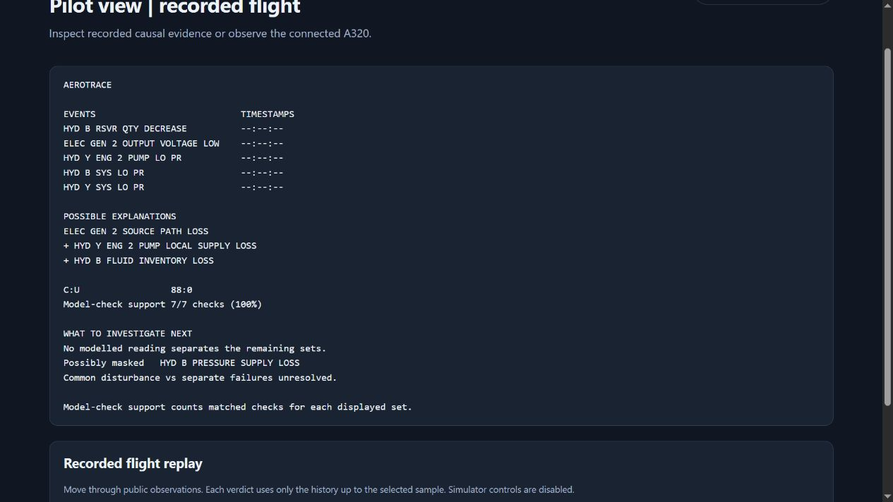

# AeroTrace v1.3 investigation comparison

The v1.3 investigation adds explicit masked-fault explanations, counterfactual
queries and passive measurement partitions while preserving every original
v1.2 fit in this comparison. It cannot identify an unobserved physical common
initiator from timing alone. [Machine-readable results](comparison.json)

The comparison used the public v1.2 commit
`9101b111de790c50ac0af777d01c99284d88d43e`, five existing development cases,
six separately specified synthetic cases and one fresh native FlightGear
control. Both versions received identical observation bytes and bounds.
Each epoch's original evidence, candidate fits, complete onset-history list
and exclusions matched exactly in all 12 cases. The actual synthetic or
native mechanism set remained represented in 10 of 12 cases in both versions.
The two exclusions are explained below.

In this report, ENG means engine, GEN means generator, HYD means hydraulic,
EDP means engine-driven pump, B means Blue, and Y means Yellow. N2 is the
engine core-speed indication as a percentage of its reference speed. C and U
count compatible and unconfirmed onset histories. A surviving set can contain
multiple histories. The set count concerns selected mechanisms, and leaves
their physical initiating origin unresolved.

| Case | Investigation target | Surviving sets | C | U | Actual set retained in both versions |
| --- | --- | ---: | ---: | ---: | --- |
| D01 | ENG 2 cascade with independent B pressure loss | 4 | 42 | 0 | Yes |
| D02 | Earlier GEN 2 fault, later ENG 2 loss | 4 | 20 | 0 | Yes |
| D03 | All five mechanisms, close early onsets | 1 | 3 | 0 | Yes |
| D04 | Engine-drive channels missing | 5 | 0 | 87 | Yes, among larger alternatives |
| D05 | Hidden trigger, four local paths | 2 | 88 | 0 | Yes, beyond the minimal set |
| H01 | Independent close GEN and B pressure changes | 1 | 3 | 0 | Yes |
| H02 | Independent source-loss fixture with inconsistent line pressure | 0 | 0 | 0 | No |
| H03 | Earlier B decline, later pressure fall near GEN loss | 2 | 16 | 0 | Yes |
| H04 | B pressure falls before inventory indication | 1 | 3 | 0 | Yes |
| H05 | Withheld engine-drive evidence | 5 | 0 | 23 | Yes |
| H06 | B pressure loss and an unmodelled bus-loss path | 0 | 0 | 0 | No |
| N01 | Fresh independent GEN 2 and Y EDP interventions | 1 | 3 | 0 | Yes |

The five development cases retain their existing fits. In D01 the ENG 2
dependency remains the shared explanation for GEN 2 and Y pump output, while
the B pressure mechanism stays separate. In D02 the retained-drive witness
still requires a local GEN path after engine power subsequently falls.
D03 preserves three early onset histories without inventing their order.
D04 retains both engine-origin and separate-source explanations when its
drive channels disappear.

D05 demonstrates the distinction between a minimal explanation and the true
synthetic mechanism set. The minimum contains GEN 2 source loss, Y EDP local
supply loss and B inventory loss. Adding B pressure-supply loss remains
compatible and is explicitly labelled potentially masked. The first observed
B pressure degradation is 2,400 pounds per square inch with a same-poll
quantity indication of 7 raw model units against a reference of 8. The
existing inventory-first relation is consistent. The model has no numerical
depletion boundary that would identify which pressure path produced that
reading. Its current measurements cannot separate the two sets.
[Exact flagship output](flagship-case05/report.md) · [Detailed evidence](flagship-case05/report.json)

Counterfactual checks covered all 32 exact mechanism sets and each of five
root exclusions for every case. All 444 answers agreed with the original
executable fit. This establishes query consistency with that model.
In D05, a generator-only explanation contradicts observed B inventory,
B pressure, Y pump output and Y line pressure. The detailed output includes
those measurement references. [Counterfactual implementation](../../aircraft_debugger/investigation.py)

For D04 and H05, either usable incident-time N2 or fuel-flow evidence partitions
five surviving sets into four containing engine power loss and one containing
separate source losses. A conclusive result eliminates at least one set and
could eliminate four. An unavailable or unknown result eliminates none.
In H05, restoring each withheld channel separately actually left four sets,
matching the predicted branch. Both D04 channels remain unavailable, so the
screen offers no actionable measurement for that capture.

A separate software test used a real one-poll prefix of the archived local
GEN/Y pair. The readable channels still lacked sufficient reference coverage.
The ranking selected B quantity with a worst-case reduction from 24 to 12
sets. Supplying the next qualified quantity poll while withholding the other
unresolved measurements left exactly 12 sets in its predicted branch. This
checks the actionable path as well as missing-channel handling.

Potentially masked roots remain qualified possibilities. D01, for example,
also admits local GEN and Y pump mechanisms that were absent from its
synthetic truth. V1.3 exposes this observational ambiguity. Across the test
inputs, neither version asserted an identified physical initiating cause.
V1.3 labels root support within each candidate separately from a compatible
additional mechanism. Model-check support on the pilot screen includes its
numerator and denominator, such as 7/7 checks. The displayed percentage
counts matched checks and conveys no cause probability.

The common-origin screen also raised unresolved possibilities on H01 and
N01, even though their separate intervention provenance describes independent
faults. If any surfaced common-cause possibility is counted as a suspicion,
that is 2 of 6 independent controls overall and 2 of 2 coherent close-onset
controls. No physical common event was asserted. H03 was treated as a possible
continuation of an earlier inventory-loss path, while H04 had separated effect
onsets. The other two controls produced catalogue mismatch.

These findings show the limitation of timing as an origin discriminator.
The screen tests known shared paths first and preserves independent histories.
It reports the missing exposure or upstream evidence needed for physical
attribution. An unset screening flag leaves physical events outside the model
unassessed, including a common disturbance with different response delays.
The provisional three simulator second screen is documented for owner review.
[Method and scope](../../docs/CAUSAL-INVESTIGATION.md)

H02 is a failed synthetic fixture. Its intended local GEN/Y fault set was
excluded in both versions because it retained Y line pressure at 3,000 pounds
per square inch while EDP, electric-pump and transfer readings all stayed at
zero beyond the settled window. That contradicts the measured-supply relation.
The fixture and exclusion are retained. H06 deliberately places a bus-loss
mechanism outside the five-root catalogue. The observed bus anomaly with the
generator source retained yields no joint fit and an explicit residual. Its
missing true mechanism remains an acknowledged scope failure.

The held-out profiles were fixed before their first evaluation and were
generated from independent channel envelopes without importing the diagnostic
graph. They reuse one nominal sample and have deliberately assigned endpoints.
The same developer knew the diagnostic model. These are software challenges,
with the H02 consistency failure retained. The fresh native control supplies
an additional check under one pinned simulator condition. Neither source
independently validates real aircraft physics or establishes generalisation
across aircraft, operating conditions or initiating damage.

The N01 recording contains 45 public polls, including 19 baseline polls.
The collector required at least 15 advancing simulator seconds of stability
and fresh final admission. Actual altitude stayed between 6,095.70 and
6,096.12 feet and airspeed between 230.52 and 230.55 knots. Separate native
GEN 2 and Y EDP flags were enabled after the spectator notification.
Their outputs reached zero while ENG 2 N2 stayed between 77.56% and 77.64%.
Y line pressure stayed at or above 2,540 pounds per square inch with measured
transfer supply. Both flags were verified clear afterward. Independent here
describes separately controlled mechanisms, without an assumption of
statistically independent random failures.
[Public observations](native-independent-pair/observations.jsonl) · [Provenance](native-independent-pair/provenance.json) · [Original collector evidence](native-evidence.zip)

Runtime measurements used Python 3.13.14 on Windows. Each value is the median
of three complete inference runs on preloaded rows. Version order alternated
between cases. A separate traced run measured peak Python allocations,
excluding the preloaded input. Milliseconds are abbreviated ms. KiB denotes
kibibytes, each containing 1,024 bytes.

| Case | v1.2 ms | v1.3 ms | Peak KiB in each version |
| --- | ---: | ---: | ---: |
| D01 | 2162.9 | 2131.9 | 4570.3 |
| D02 | 2166.2 | 2146.9 | 4661.7 |
| D03 | 2177.0 | 2199.6 | 4661.7 |
| D04 | 2031.2 | 1997.0 | 4220.9 |
| D05 | 2159.1 | 2162.7 | 4664.8 |
| H01 | 470.0 | 478.9 | 2109.3 |
| H02 | 465.1 | 473.0 | 2110.6 |
| H03 | 469.5 | 478.0 | 2137.1 |
| H04 | 471.1 | 468.6 | 2080.4 |
| H05 | 440.8 | 436.6 | 1979.9 |
| H06 | 468.9 | 472.0 | 2056.3 |
| N01 | 340.5 | 348.7 | 2189.4 |

The median of per-case v1.3/v1.2 runtime ratios was 1.0042. Individual ratios
ranged from 0.9831 to 1.0241. FlightGear, local panels and other background
processes were running, and brief browser and report checks overlapped the
benchmark. These differences cannot establish a small speed change.
Peak traced allocations were identical in each pair because shared evidence
extraction dominated the observed peak. This leaves retained payload size,
native process memory and broader live-latency behaviour unmeasured.

All 230 automated tests passed. The suite includes the existing exhaustive
onset-order software exercise and ten focused investigation tests. Browser
checks verified the complex inspector, replay seeking and concise pilot output
with no console errors. The recordings begin airborne, so their pilot
ground-power timestamps remain unknown. [Test log](tests.txt) · [Reproduction commands](../../docs/CAUSAL-INVESTIGATION.md)

The comparison records executed source hashes and the fixed protocol hash.
The development bundle preserves the five original observation files and
their original shared bounds byte for byte. Existing raw experiments and
sealed results were read without modification. [Development fixtures](development-fixtures.zip) · [Evaluation protocol](../../configs/investigation-evaluation.json)
